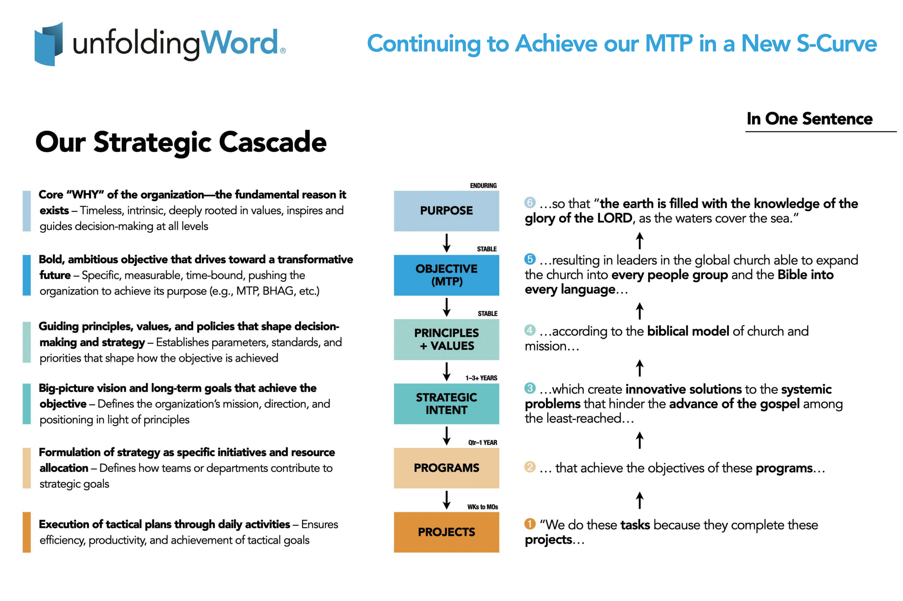

# unfoldingWord Platform: Product Requirements

This document says what the unfoldingWord Platform is, who it is for, and what each part of it does and must never do. It covers the whole platform. It is kept current: when a feature or a rule changes, this text changes in the same pull request.

It does not carry status. What exists and what is still to come is tracked in the GitHub epic and the issue named on each section's `Issue:` line. Every section is written in the same voice, as the design the platform is held to.

Companions, each with one job:

| Read | For |
|---|---|
| [`CONTEXT.md`](../CONTEXT.md) | The words. This document uses them and no synonyms |
| [`docs/architecture.md`](architecture.md) | How the platform is put together: Workers, packages, ports, schema layout, enforcement |
| [`docs/decisions.md`](decisions.md) | Why a rule is the way it is, and what was rejected. Cited here as "ADR NNNN" |
| [`AGENTS.md`](../AGENTS.md) | How work is done in the repository |

---

## 1. What the platform is and why

### 1.1 Vision

> One operating platform for the whole organization: one database, one login, every module built on the same pages, records, access rules and agent boundary.

unfoldingWord runs on disconnected systems: an accounting system for actuals, a CRM for contacts and giving, a wiki and project tool for knowledge and plans, a spreadsheet for the rolling budget, a separate database for field reporting, and GitHub for software work. Program leads reconcile money, work and outcomes across them by hand, and document the discrepancies by hand. The same program is named three different ways in three systems.

The platform replaces that with one integrated system the organization owns, where a single chain of joins answers the question that today takes a week of stitching:

> a training event or language engagement → its program → its portfolio → its fund → the grants and gifts behind it → the people who gave

It is designed so that a very small team, working with AI agents as governed coworkers, can make and run it. Agents take part in real work everywhere on the platform, and a person decides wherever the work would have an effect on the world.

> Agents do the work. A person decides what reaches the world.

### 1.2 Why build it

- **Integration is the product.** Each system being replaced is adequate alone. The cost is in the seams: duplicated taxonomies, hand-kept foreign keys, numbers that disagree. One dataset removes the seams.
- **The organization should own its operating record.** Markdown pages and typed records in a database unfoldingWord controls can always be exported, read by any future maintainer, and audited.
- **Agents need one shape to work against.** A small set of single-purpose verbs over one canonical dataset lets an agent draft a grant report, allocate an expense or triage intake with the same access rules a person has, and with no path past a human gate.
- **It fits the mission.** unfoldingWord already runs open infrastructure. The platform is an open-source repository that another organization can adopt module by module (section 3).

### 1.3 Who it is for

| Who | What they need from it |
|---|---|
| Every staff member | Find and read how the organization works; keep their tasks; see the programs, projects and people they work with |
| People who decide | See what is waiting on them and the facts behind it, and decide from a phone: a gate on a workflow, a work order, an expense, a publish request, a reveal of a credential |
| Area admins | Run their area: grants, pages, collections, credentials, workflows and the agents that work them |
| Finance (areas `20-29`) | A fund-accounting ledger, budgets, contracts and work orders, expenses, month-end and the audit binder |
| Fund development (areas `40-49`) | Contacts, gifts with soft credits, acknowledgments, the grants pipeline and grant reports |
| Field programs (areas `60-79`) | Engagements, training events, translation outputs, impact models and stories, usable where connectivity is poor |
| People who lend agent time | Point their own Claude Code or Codex at a workflow and work an item on their own subscription |
| Agents | Identities that reach the platform only through the MCP surface, each running a persona with a toolset chosen from one verb registry |
| Auditors and the board | Generated, reproducible artifacts whose every figure traces to its source records |
| Adopting organizations | A set of modules they can take in part, with the two axes of section 3 explained well enough to set up their own |

**Not designed for:** donors, partners or the public as people who sign in. They are reached only through what a person publishes or sends: the public site, a shared report, an acknowledgment.

### 1.4 Product principles

- **Pages and records.** Everything a person reads is a page. Everything with financial or referential integrity is a typed record that points at a page for its narrative. A money fact is never stored only in a page's properties.
- **Markdown is the record.** A page's body is whole-document markdown, saved as numbered versions. Editors, sync and rendering are layers over it; if any of them were removed, the corpus would be complete without it.
- **The gate is the absence of a route.** Safety comes from verbs that do not exist and constraints the database refuses, never from instructions in a prompt. No agent identity can approve, merge, deploy, publish, post a journal entry, send donor email or advance work past a human gate.
- **Grants, not names.** Every "who may" resolves through role grants and one `can(actor, verb, resource)`. No module has an authorization model of its own.
- **Closed until granted.** A new area, table or property is unreadable until someone grants access. Openness is a visible, audited grant, never a side effect.
- **Invariants live in the database.** A ledger that balances, a log that cannot be rewritten, a gate that needs a person: these are constraints and triggers, so they hold whatever code or agent talks to the database.
- **Evidence over confidence.** A claim carries how it was verified. A figure in a report clicks through to its source. An agent's proposal marks each value as observed, confirmed, inferred, assumed or unknown.
- **Render the absence.** When a sync failed or data is stale, the screen, chart or report says so in place. It never shows a short series or an old number as if it were whole.
- **Config is data, capability is code.** A persona, a workflow template, a collection and a saved view are rows and pages. A verb, a validator, a connector, an engine and a data adapter are reviewed code in a registry. Config selects from registries and can never add to one.
- **Every control returns an outcome.** `accepted` or `error` with a closed-set reason. A control that is not wired says so. A refusal is shown in place, on the control that refused.
- **Read first, edit on purpose.** Nothing is editable until a person asks. Editing happens in place, and nothing on the page moves when it starts or stops (ADR 0029).
- **Everything is exportable.** Every module has a documented export path. Nothing imports from a custom schema, so the platform never holds data hostage.
- **Reuse before writing.** Validated open-source packages carry the feature sets others have already built; the platform writes only the integration and the domain logic that is its own. The rule and the current choices are in `docs/architecture.md`.

### 1.5 The feature test

Every proposed feature is placed on the spine before it is designed:

> source systems → the canonical dataset (pages and records) → the MCP surface (small, single-purpose verbs) → screens, apps and agents, with institutional memory woven across

A feature that does not sit on the spine is a side system, and the answer is no. A feature that sits on it must then pass two questions:

1. Does it move work, money or knowledge through the platform, or let a person see and decide on it?
2. Can it be done without giving any agent identity a way past a human gate?

If the second answer is no, the feature does not belong at all.

---

## 2. Conventions that bind every module

Small rules, chosen once and enforced mechanically. In a system this wide the cost of inconsistency is paid forever, and agents reading and writing the corpus need one shape to match.

### 2.1 Dates

**Dates are always ISO 8601, `YYYY-MM-DD`, everywhere.**

- **Display and entry:** `YYYY-MM-DD` in every screen, table, chart axis, filename, export, PDF footer, log line and agent-facing answer. A time is `YYYY-MM-DD HH:MM` with an explicit time zone label when the time matters. No `MM/DD/YYYY`, no `March 3, 2026`, no locale-dependent rendering: a finance lead in the United States and a field partner in Chad read the same string the same way.
- **Stored** as a calendar date or a UTC instant, never as a formatted string in a data column.
- **Derived forms:** periods `YYYY-MM`, quarters `YYYY-Q1`, ranges `YYYY-MM-DD..YYYY-MM-DD`. Date-stamped slugs and filenames lead with the date so they sort correctly.
- **One pair of functions** formats and parses dates for the whole platform; anything else fails the build. Imports from other systems normalize on the way in, and a date that cannot be parsed lands in a quarantine report instead of being guessed.

ISO dates sort as text, are unambiguous across the countries unfoldingWord works in, are stable in diffs and CSV round trips, and are what agents parse most reliably.

### 2.2 Money

Money is an integer count of minor units with an explicit currency. Never a float. Amounts in another currency keep the original amount, the exchange rate and the functional-currency amount. One shared helper formats money for display.

### 2.3 Identifiers and text

- Identifiers are UUIDs, with human-facing slugs in lowercase kebab-case.
- Johnny.Decimal: an **area** is one decade (`20-29`), a **category** is two digits (`21`), an **ID** is `NN.NN` (`21.10`).
- Languages use IETF tags. Countries use ISO 3166-1 alpha-2.
- All text is UTF-8 markdown.
- Every boundary validates with a schema: a request, an event, a page's properties, an import row.

### 2.4 Classification

Every table and page type declares two things before it can exist:

- a **classification**: `public`, `internal`, `restricted` or `sensitive`;
- an **offline eligibility**: `sync` (may be replicated to a device), `cache_readonly` (a short-lived read cache that expires offline) or `never` (does not leave the server).

A table or type without both fails the build, so the default is "you must decide", not "it quietly syncs". Section 4.1 says what each classification means for who can read.

### 2.5 Provenance

Every synced or imported fact carries where it came from: source system, source id, when it synced and whether the sync succeeded. Screens show it, and show the absence when a sync failed. Each entity keeps every source system's name for it, so a CRM contact id, a payment-processor customer and an accounting vendor resolve to one record.

### 2.6 Copy

Sentence case, second person, no exclamation marks, no emoji. Navigation items and page names are Title Case. `unfoldingWord` is camelCase every time. Kindle orange marks a human action and nothing else.

---

## 3. Modules

### What a module is

A platform this wide cannot be understood or rolled out as one mass. A **module** is a named, documented slice that can be turned on by itself. It owns its tables, page types, routes, verbs, workflows, scheduled jobs, policies and permissions. The registry is `packages/core/modules.ts`, and each module is rendered from it as a page in the platform.

Rules that keep modules real:

- A module depends only on modules it declares. It reaches another module through a published interface, a typed function or a verb, and **never by joining into another module's tables**. The build checks this.
- A module can be enabled for the whole organization or for one area, and as a pilot. Disabling it removes its routes, verbs, navigation and scheduled jobs, and its API answers "module not enabled" by reason, not an error.
- A module is complete only when it has four things: a runbook page, a data-export path, its verification steps, and its classification and offline declaration.
- A module without a home in the sidebar yet sits under "More", not dimmed in place (ADR 0029).

Modules are the unit of adoption. Another organization can take Core, Strategy and Story Bank and never stand up a ledger; one that wants only fund accounting can take Core, Ledger and Compliance.

| Module | Depends on | Owns |
|---|---|---|
| Core | | Pages and versions, the knowledge base, collections and saved views, tasks, files, search, the Johnny.Decimal registry, access, credentials, the policy engine, suggested changes |
| Strategy | Core | The cascade (portfolios, programs, projects), OKRs, charters, the JD Crosswalk |
| Directory | Core | People, organizations, Areas of Responsibility, profiles |
| Agents | Core | The MCP surface, personas, institutional memory, skills |
| Workflow | Core, Agents | Workflows, stages, items, gates, runs, delegations |
| Ledger | Core, Directory | General ledger, funds, functions, budgets, periods, assessments |
| Contracts | Ledger | Agreements, work orders, commitments, partner invoices, signed copies |
| Expenses | Ledger | Reimbursements, corporate cards, receipt intake |
| CRM & Giving | Core, Directory | Contacts, gifts, soft credits, online giving, acknowledgments |
| Grants | CRM & Giving, Strategy | Pipeline, funder templates, grant reporting |
| Field Data | Strategy | Engagements, training events, translation outputs, field organizations, reference imports |
| Impact | Field Data, Strategy | Impact models, metric definitions, snapshots |
| Story Bank | Core | Impact stories, consent, sensitivity, usage tracking |
| Publishing | Core | The publish flow and the public site |
| Documents | Core | PDF and DOCX output, letterhead, binders |
| Charts | Core | Chart specs, the standard chart library, dashboards |
| Dev | Core | The GitHub read model, sprints, epics |
| Comms | Core | Zulip, Zoom, Calendar, the correlation engine |
| Desktop & Offline | Core | The sync protocol, the local replica, the markdown vault |
| Observability | Core | Health, logs, service levels, alerts |
| Infrastructure | Core | Declared infrastructure, backups, restore drills, stewardship |
| Compliance | Ledger, Core | The obligation registry and generated reports |

Issue: #195 (module registry and enablement), under epic #205.

### Core

Core is what every other module stands on.

#### Pages

A **page** has a type, an area, a slug, a title, an optional parent, typed properties and a markdown body. Every save is a new numbered **version** with who saved it, a person or an agent. A save is refused when it is based on a stale version, would make a parent cycle, or would duplicate a slug.

- **Page types are a controlled vocabulary.** Each type has a property schema, a classification, an offline eligibility, a default template and default views. The registry is `packages/contracts/page-types.ts`. Types cover wiki knowledge, the entities of the cascade, institutional memory (decisions, learnings, skills), governance (policies, charters, runbooks, templates), meetings and transcripts, impact stories, intake, and the pages that describe the platform itself (a page per module, a health page per module).
- **Reserved IDs** carry a convention in every area: `xx.96` impact stories, `xx.97` templates, `xx.98` meetings, `xx.99` archive.
- **Statuses** are `draft`, `suggested`, `active` and `retired`. Retire is the trash; a retired page can be restored.
- **Links** between pages are stored by page id, so renaming or moving a page breaks nothing. The link table is rebuilt on every save and distinguishes a link, an embed and an unresolved link. Backlinks are a read over it.
- **Properties are not merged character by character.** They are typed values written through commands. Two people changing different properties both win; the same property takes the later write, and both are in the history.

#### The knowledge base

The knowledge base is the organization's wiki: how we work, policies, handbooks, guides.

**Read first, edit on purpose.** A page's address is always its **read view**: rendered markdown, breadcrumb, contents, properties, backlinks, the pages under it and its history. The read view never holds a field that can change the page. A pencil or Edit button, shown only to someone who may write, opens edit mode at its own address, and the `e` key does the same. Edit mode draws the same frame and layout as the read view, so moving between them changes what can be typed and not where anything is (ADR 0026, ADR 0029). There is no "always editable" preference, because that would bring stray edits back for anyone who chose it.

**Filing.** Every knowledge page is filed in one category. Its area is that category's decade, set by the server so the two cannot disagree; a page's ID, when it has one, begins with its category. `60-79 Field Programs` is a **cluster**: a label over two areas in navigation. A cluster holds no pages and takes no grant. A category's name is data an area admin sets. Moving a page to another area needs the editor role in both, keeps the page's id so links hold, and clears its ID because the old number names the old category (ADR 0031).

**Finding a page.**

- The **page tree** lives in the sidebar under "Pages & Wiki": each area the reader may read, its categories, and the pages in the category they are in, with the current page marked.
- Each area may name one page as its **area home**, a hand-kept landing page shown beside the generated tree.
- The **Quick Switcher** opens on Cmd/Ctrl+O and Cmd/Ctrl+K from every screen. With nothing typed it lists recently viewed pages. Typing matches titles, IDs and aliases loosely, so `0147`, `sec guide` and `security` all find `01.47 Security Guidelines`. Its last rows offer full-text search and, for someone who may write, creating a page with that title.
- **Full-text search** covers title and body, with title, ID, tags and overview weighted above the body. It stems English, accepts anything a person types including quoted phrases and `-word`, shows a snippet per result, and suggests a near title when nothing matches. Filters: area, type, owner, updated since. The search screen, the JSON route and the agent verb call the same function, and every one of them returns only pages in areas the reader may read. Two people can see different results for the same words.
- Agent and workflow page types are not listed in the wiki by default, so mirrored issues and agent pages do not bury it. They are reachable by search with a type filter.

**Writing.**

- The stored format is GitHub-flavoured markdown plus three additions a plain markdown reader still shows sensibly: alert blockquotes for callouts (`> [!NOTE]`), `<details>` for collapsible sections, and `==text==` for highlight. Rendering happens on the server and is sanitised, so the web screen, a phone app and a PDF get the same HTML.
- **Wiki links** work wherever text enters the platform: the editor, plain markdown, an agent's write and an import. `[[Page title]]`, `[[01.47]]` and `[[Page title|shown text]]` are resolved on save, by exact ID first, then exact title or alias, preferring a page in the same area. A title that matches several pages is left as written for the author to choose. A link to a page that does not exist yet stays as written, offers to create the page, and resolves by itself once the page exists.
- **Transclusion** shows one text on several pages, edited in one place: `![[Page title]]` embeds a page and `![[Page title#Heading]]` one section. The embedded text is framed, names its source, and is read-only in place. Access is checked for the reader, not the author: a reader who may not read the source sees "You do not have access to this section" and nothing else about it. A page cannot embed itself directly or through a chain, and embeds nest two levels at most. Search finds embedded text once, on its source; exports write it out in full.
- **The editor** is a formatted editor whose own source is markdown, so the stored body never becomes an editor's private format. A page the editor would change in meaning by opening it opens as plain text instead, with a line saying why. No page is rewritten by being opened (ADR 0030).
- **Working drafts.** Everyone in edit mode on the same version of a page shares one **working draft** through a **sync hub** and sees each other's cursors. Only someone who may write the page can join, and that is checked again at Save and at least every five minutes. **Nothing reaches readers until Save.** Save publishes the draft as one new version; Discard asks first and says how many others it affects; leaving keeps the draft. Readers, search, agents and exports only ever see the last saved version.
- **A save from elsewhere is announced, not merged.** If an agent, the API or a restore saves a newer version while a draft is open, the people in the draft are told, the draft's Save is refused as stale, and each person keeps what they typed to edit alone. An agent's write is never merged into an open draft (ADR 0030).
- **Files and images** are stored privately and served only through a route that checks the reader may read the page's area. Paste or drop an image in edit mode to upload it.

**Looking after pages.** Create, rename, move, duplicate, retire and restore. History compares any two versions as a line diff and can restore one. Favourites and recently viewed. Templates. Comments on a page and on a passage. Export to markdown and PDF. An owner and a verification date on each knowledge page, a list of pages whose verification has lapsed, and a reminder to the owner when it does.

**Deliberately absent:** block storage, inline databases with a private schema inside a page, multi-column layouts and cover images, and per-page sharing. A page's area is its scope.

**Built for a second client.** Every screen is drawn from a read function that also has a JSON route, and every change goes through a command in the contracts package. An answer about a page carries what the caller may do with it, so no client re-implements the access rules. The web screens have no private path.

**Moving from Notion.** The import is one job that can be run again, with a dry run first. A leading `NN.NN` in a title gives the ID, category and area; a page with neither is listed for a person to file. Owner, tags, overview and verification become properties. Synced blocks become small pages that every place embeds. Links are rewritten in a second pass once every page exists, and a link to something not imported stays a Notion link and is listed. Each page keeps its Notion id so an old bookmark can redirect. Databases, cover images and comment threads are left behind on purpose, and counted in the report. The import is complete when a sample of pages across areas matches Notion by eye, every internal link resolves, and a person has set the Notion knowledge base read-only with a banner pointing here.

Issue: #175 (knowledge base), #176 (Notion content migration). Rules: ADR 0026, ADR 0029, ADR 0030, ADR 0031.

#### Collections and saved views

A **collection** is a set of rows with typed **properties**, listed and queried through **saved views**. It is how the platform holds what the organization kept in Notion databases: the program portfolio, the project list, the colleague directory, task lists, and every database-shaped thing after them. The parts are general, so a new collection is configuration, not a pull request (ADR 0023).

- **A collection's schema is data.** An area admin defines properties, their types, options and status groups. Every change is validated against the rows that exist and against every other collection it relates to, and each change is a new version of the definition. A change that would break a saved view is refused with the views named. A property's type change converts every row or none. A **locked** collection refuses every definition change except unlocking. Changing a definition is a person's command; no verb does it.
- **A collection lists pages or typed records.** Its rows are pages, tasks or people. Each property declares its source: a page property, a column of the record's own table, a relation, a computed value, a read-through feed, or a system field such as created and last-edited time and the time the row entered its status's complete group. A write to a record always goes through the module that owns the record.
- **The property catalogue** is `packages/contracts/collections.ts`. It covers text, numbers, selects with an option order, status with to-do, in-progress and complete groups, people, dates and date ranges, links, contact fields, checkboxes, files, relations (one-way or two-way, to another collection or to itself), rollups and computed values.
- **Computed values are a closed set**, not a formula language: sum, difference, count and days-until, plus rollups over a relation. A general formula language is a later decision.
- **A collection owns no money.** The catalogue has no money type. Budget, actuals, committed, remaining need, balance and income by source are **read-through** properties served by the budget and ledger modules, shown on the row and edited only in the process that owns them. A feed with no source says so; a project with no budget lines shows "no budget lines yet", never a number. Read rules follow the money, not the collection.
- **A property can be classified narrower than its row** (ADR 0024). A directory row is `internal`; its phone, mailing address and compliance fields are `restricted`, read by the person themself and by the area that stewards them. The query drops a property the reader may not see before rows leave the database, refuses a filter, sort or group on it so values cannot be learned by narrowing, and leaves out any rollup or computed value that depends on it. A property a person cannot read, they cannot write.

**Saved views.** A saved view records its layout, filter, sorts, grouping, shown properties and order. Shared views belong to the collection; personal views belong to a person.

| Layout | Use |
|---|---|
| Table | Column choice and widths, several sort keys, editing in place for properties the person may write |
| Board | Grouped by status, select, person or relation. Moving a row between groups writes the property through a command and returns an outcome. Each group can carry a WIP limit, and the order of rows is kept per view |
| List | One line per row |
| Gallery | A card per row with chosen properties |
| Calendar | Rows placed by a date or date range |
| Chart | A count or sum by group, drawn as a chart, with the figures also on the page as text |
| Timeline | Rows across a date range, for program and project durations |

Filters accept relative values such as "me", "today" and "this week", resolved on the server. The same query serves the screen, the agent verbs and exports, and is always intersected with what the reader may read. History charts, cycle time and cumulative flow, are read from status changes in version history.

**The row page.** A row opens as a page: property sections that can hide when empty, a relations panel listing what points here, then the body and comments. A collection can have several templates, and each view names its default.

**View embeds.** A saved view can be shown inside any page, so an area home can hold views beside prose. An embed never widens access: the reader sees what the view would show them and no more.

**Agent reach.** An agent can read a collection's definition and a saved view, create a row and set a property, each behind `can()` on the area. Changing a definition and moving anything past a gate stay with people.

**Moving from Notion.** The colleague directory, the task lists, the program portfolio and the project list import with their options, status groups, people, relations and views. A dry-run report lists the cleanups a person confirms: duplicate options, names kept as a select, hand-kept dates that become system fields, and filter rows that do nothing. Organizations kept as select options become organization pages and relations. **Money figures are never imported as values**: they are reported beside the budget's figures for a person to reconcile.

Issue: #206 (collections and saved views), #207 (Notion database migration). Rules: ADR 0023, ADR 0024.

#### Tasks

Tasks are universal. One list serves every team and every person: a task has a title, status, assignees, due date, priority, tags, a description, files, related tasks, an optional parent page of any kind, and a source (written by a person, extracted from a meeting, or suggested by an agent). A team's task list is a saved view filtered by area; "My Tasks" is a list view filtered by assignee "me". A task extracted or suggested by an agent stays `suggested` until its owner confirms it with one click, so an extracted to-do never silently becomes a commitment.

Issue: #206.

#### Suggested changes

Three things are kept distinct, because collapsing them is how document systems become untrustworthy:

- a **version**: an immutable snapshot, one per save;
- a **suggestion**: a proposed change waiting for a decision, not yet part of the document;
- **revision marks**: the rendering, for a reader, of what changed between two versions.

A suggestion is anchored so it survives edits to the rest of the document, with a quoted-text fallback so the same anchor resolves against exported markdown. A **review set** bundles suggestions into a named unit, such as "Board review 2026-09-01" or "Counsel redline of the Chad MOU", that is accepted or rejected as a whole and produces exactly one new version and one audit record.

**Agents suggest; they do not overwrite.** On policy, charter, contract and work order pages an agent's write becomes a suggestion set. The in-place write does not exist for those types.

**Built so far, for policies and charters (ADR 0035).** An agent's save to an active policy or charter runs every check a save runs and is then held as a **suggestion set**: the whole proposed title, properties and text over the version it was based on. Each agent holds at most one pending set per page; saving again replaces it. The page says a change waits and links to a review screen that shows the text and the properties as a line diff, with Accept and Reject for someone who may write the page. Accepting saves the set as exactly one new version, through the same checks as any save; rejecting changes nothing. Both are recorded on the set, which the database then keeps as it was decided. A set whose base is no longer the page's version can only be rejected. Each save by the agent bumps the set's revision, and a decision names the revision the person read, so nobody accepts text they did not see; the same decision sent twice is answered once. Anchored suggestions inside one document, named review sets and revision marks in exports are not built yet.

Revision state survives every export:

- **Markdown** carries revision marks as CriticMarkup, plain text that is diffable and readable in any editor. Three modes: marked, accepted (clean current text) and original.
- **PDF** has three modes: clean, redline (insertions underlined, deletions struck, change bars, numbered margin notes), and clean with a revision appendix listing every change with its date, actor, versions and rationale. Contracts, work orders and policies default to clean with appendix, so a document sent for signature states on its face what changed since the last executed version.
- **DOCX** maps the marks to Word tracked changes for counterparties who redline in Word. Importing their file lands their edits as a suggestion set, never as an overwrite.
- **Data exports** carry the version, the as-of time and the source hash.

Issue: #197.

#### The policy engine

A **policy** is a page with a level (organization, portfolio, program, project or product), an enforcement (`required`, `default` or `template`), what it applies to, what it supersedes and when it takes effect. Its level is the type of the page it applies to: a portfolio, program, project or product page, or none for the whole organization, so the two can never disagree. A policy that names a page that is not a live node or product, or one the writer cannot read, is refused.

Resolution walks from the most specific level upward: the item's product, the node it or its product is placed under, that node's program and portfolio, then the organization. A policy counts only between the date it takes effect and the date it ends. A `required` policy at a higher level cannot be overridden below; a `default` yields to a descendant that supersedes it. A policy that tries to supersede a `required` one, or one at its own level or above, changes nothing, and the attempt is recorded as a conflict. A `template` policy binds nothing and replaces nothing until it is copied. Every candidate on the chain takes part, however many there are. A template is **copied** into the thing made from it, with its source and version recorded, so obligations never change silently; a drift report makes adopting a template update a deliberate act. A person copies a template policy from its page, choosing a title, what the copy applies to, its enforcement and its start; the copy lands as suggested. The Policies screen lists every copy whose template has moved on, been retired or gone, and a copy behind its template offers to adopt the template's new text as one new version, only while the template is still an active template policy, and only at the version the person was shown.

Every policy a person can read is listed on the Policies screen with its level, target, enforcement, dates, status and the number of conflicts it is part of. A policy's own page shows the same facts and names each conflict: which policy tried to replace which, and why the replacement had no effect.

Charters use the organization's NISO format (Need, Idea, Strategy, Outcomes, with Risks and Roadmap) as a validated template, so they stay machine-readable at every level. The six are level-two headings in the charter's body, in that order; a save without them is refused and names the missing ones.

Policies, charters and decision pages are gated: an agent's new page lands as suggested, and a person confirms it from the page, which runs the same checks as a save. An agent's save to an active policy or charter is held as a suggestion set for a person (Suggested changes, above).

A **decision page** records context, decision and consequences as level-two headings, the date it was decided, what it applies to (a node, a product or the organization) and what earlier decision pages it supersedes.

An agent loads the resolved policies, decisions and learnings for an entity through `resolve_context` before it acts (section 4.2). It answers the policies in force for the item that the caller may read, most specific first, each with its level and enforcement, and the decision pages on the same chain, most specific and then newest first, leaving out any that a decision decided later supersedes (on the same day, unless both name each other).

Issue: #243. Rules: ADR 0034, ADR 0035.

#### Credentials store

Area credentials are the secrets that belong to an area's work: partner APIs, portals, funder systems, bank exports. The store guarantees:

- A credential is filed in an area and can be pinned narrower, to a category or an ID. Only a grant on that exact area reaches it.
- **Using a credential and seeing its value are different capabilities.** A credential answers four, and never `read` (ADR 0018):

| Capability | What it lets you do | Who |
|---|---|---|
| `see` | Know it exists: name, owner, expiry, last use. Never the value | `viewer` or higher on the credential's own area, and an org admin; a person at the keyboard |
| `use` | Have platform code use it on your behalf, without seeing it | `editor` or higher on that area, and only from a workflow and connector the credential is bound to. Never through an org grant |
| `reveal` | See the value | Nobody by default. Needs `see` plus a live reveal grant for that person on that credential; a person at the keyboard |
| `manage` | Create, rotate, revoke, bind, give a reveal grant | `admin` on that area, and an org admin; a person at the keyboard |

- An org admin can see and manage every credential, so someone can rotate or revoke when an area admin is unavailable, and can never use or reveal through the org grant. Org editors and org viewers get nothing.
- **Agents never receive a value.** A person names a credential by reference in configuration; platform code opens it for the length of one outside call and discards it. No verb returns a value and none takes a reference (ADR 0020). The check is made against the run's person and their grants as they are at that moment, and made a second time after the key service answers, so a revocation during the call wins (ADR 0019).
- A **binding** names the workflow and connector that may use a credential. A grant alone is not enough.
- **A copy of the database reveals nothing.** Each version of a value is sealed under its own data key, and that key is wrapped by a key held outside the database (ADR 0019). Rotating adds a version.
- **A reveal** is one uncached answer, shown on an explicit action and forgotten by the browser after a minute. It notifies the other admins of the credential's area by push, without naming the credential. A reveal grant lasts between 5 minutes and 24 hours. A reveal grant given by an org admin who is not an admin of the area counts for nothing until a second person who may manage the credential confirms it, and the two cannot be the same person (ADR 0021).
- A person who cannot `see` a credential is told it does not exist, so an id cannot be probed.
- Every use, reveal, rotation, binding and refusal is recorded in an append-only access log kept for seven years.
- **Lifecycle.** A rotate-by date notifies the owner and the area's admins. Credentials belong to the area, not the person, so they survive a departure; a person's use and reveal end when their role grants do.

**Platform secrets** are different: the keys the platform itself runs on. They are held in the hosting provider's secret store, each Worker binding only what it reads, listed with an owner and a rotation date under `30-39` Infrastructure (ADR 0022).

Issue: #156, #157, #158, #159 (credentials store), #160 (platform secrets). Rules: ADR 0018 to ADR 0022.

### Strategy

Strategy holds why work exists: the Strategic Cascade, OKRs and charters, and the map between the cascade and the filing scheme.

#### The two axes

The organization is organized twice, on purpose, and the two schemes answer different questions.



- **The filing axis: Johnny.Decimal.** Every page, task, workflow and credential is filed in one area. It answers *where do I put this, and where do I look for it?* It changes rarely; renumbering is a restructure. **Access rides this axis**, because permission follows job function.
- **The purpose axis: the Strategic Cascade.** Purpose (enduring) → Objective (stable) → Principles and Values (stable) → Portfolio, carrying its Strategic Intent (one to three years or more) → Program (a quarter to a year) → Project (weeks to months) → Task (daily). It answers *what outcome does this serve?* It is meant to change every planning cycle. **Money and outcomes roll up along this axis.**

Neither is derived from the other, and neither is the parent of the other. A project can be filed in Finance and serve a field program; those are two facts, recorded separately. When only one axis is modeled, the other is smuggled in as select fields copied onto several lists, which is exactly how the two drift apart.

How each fact is recorded (ADR 0027):

| Fact | Where it lives | Who sets it |
|---|---|---|
| An entity's area | On the entity | Whoever files it, with write on that area |
| A cascade node | A page of type portfolio, program or project, in its collection | An editor of the collection's area |
| An entity's place in the cascade | One **placement**, naming one node | A writer of the entity's area who can read the node |
| How an area relates to a node | One row of the **JD map**, with a relation | An org admin; every change is kept in full |

The four relations: an area **owns** a node when it does the work; **supports** it when it serves the node without owning it, as Finance supports every portfolio; **funds** it when it raises or holds the money; and **reports on** it when it reports to someone outside, such as a board or a funder. An area can hold several relations to one node, and a node can relate to many areas.

A portfolio and its strategic intent are one entity, because each portfolio has exactly one. A program's portfolio is a relation to the portfolio page, and a project's portfolio is a rollup through its program. No collection stores a cascade coordinate as a plain select, and a test keeps it that way. Purpose, Objective, and Principles and Values are the tiers above the portfolios: organization-level pages every portfolio sits under, with Principles and Values made executable by the policy engine. Each tier carries its time horizon.

**Products are on a different plane.** A product has one owning program or portfolio, but it can serve several, and projects can be pieces of a product's life. Relations record "delivers for" and "also serves", many to many. Rollups follow the tree by default and can pivot to the product plane.

#### The JD Crosswalk

The crosswalk is a real screen: areas down, cascade tiers across. Each cell counts the pages, tasks and items filed in that area and placed at that tier, and lists the area's relations to that tier's nodes. A cell opens the list of what it counts; a node opens every area it touches. The last column counts what is filed but not yet placed, which is the list still to do. It counts only areas the reader can read: someone with no grant on Finance sees no Finance row and no Finance relations, even on a node they can read. Over time the cells also carry committed and actual spend, stories and impact metrics.

**For an adopting organization.** Declare the map once at setup, and revisit it each planning cycle:

1. List your areas. With no filing scheme, run with one area; the crosswalk then has one row.
2. List your cascade. With no strategy yet, run with no nodes; everything counts as not placed.
3. Declare each relation that matters, starting with *owns*: every program should be owned by at least one area.
4. Place the work under the node it serves.
5. Read the crosswalk. An empty row is an area that serves nothing you have declared. An empty column is a tier with no work under it. Both are questions for the next planning conversation, not errors.

#### Strategy collections

Portfolios, programs, projects and OKRs are seeded collections. A program is keyed to its accounting program id through the budget's dimension map, so there is one program, not a second record beside it. Every money figure on these rows is read-through. OKRs form a two-level tree that programs and projects relate to.

Issue: #206 (strategy collections), #202 (JD Crosswalk), #178 to #181 under epic #182 (the budget figures these rows read). Rules: ADR 0027.

### Directory

The directory is the people and organizations the platform knows.

- **People** are the sign-in record plus a directory entry: role, team, employment, joined date, contact fields. Personal fields are classified narrower than the row (ADR 0024).
- **A person's profile is their directory row** (ADR 0025). There is one page per person, and it is what opens wherever a person appears: an assignee, a page owner, a comment author, an approver at a gate, a mention. It shows the directory properties the reader may see, a narrative body, and read-through lists of their open tasks, the programs and projects they lead or work on, and the pages they own. A person edits their own contact fields and body; role, team, employment and compliance fields are written by the people who administer the directory. Only an active person has a profile.
- **Organizations** are pages, so a stakeholder on a program is a relation to an organization and never a select option. Field organizations and CRM organizations are linked where they are the same real-world body.
- **Areas of Responsibility** record person × area × share. They are the prior for allocating an expense when nothing else says where it belongs.

Issue: #206 (directory collection), #208 (profiles), #207 (migration). Rules: ADR 0024, ADR 0025.

### Agents

The Agents module is how AI takes part in the platform's work: the MCP surface and its verb registry, agent identities and personas, institutional memory and skills. Section 4.2 describes it in full, because every module uses it.

Issue: #123 (assistants); the rest under #244.

### Workflow

Issue: #99 (agent queues), #98 and #144 (agents running hosted), #148 (GitHub data scope).

> Agents do the work. A person decides what reaches the world.

A **workflow** is a set of stages that items of work move through, with the people and agents who work them. In the code, and in `CONTEXT.md`, a workflow is a **harness**; the two words name the same thing, and this section uses "workflow" for what a person sees and `harness` where it names code or data.

The workflow module exists for two reasons. It makes one developer plus agents a credible way to build the rest of the platform, and it lets a staff member lend their own Claude Code or Codex to the queue without the organization losing control of what ships. It runs every piece of work through one loop, Build, Measure, Learn, with agents as governed coworkers and a person at every gate that has an effect on the world.

Every feature proposed for this module must pass two questions:

1. Does it move work through the loop, or let a person see and decide on work in the loop?
2. Can it be done without giving any agent identity a way to approve, merge, deploy, publish or advance past a human gate?

If the first answer is no, the feature belongs to another module. If the second is no, it does not belong at all.

#### Who it is for

- **The people who approve.** Holders of `admin` on a workflow's Johnny.Decimal area. They see what is waiting on them, see the facts behind a ship decision, and decide from a phone.
- **The people who lend agent time.** Staff, volunteers and contractors holding `editor` on a workflow's area, who point their own agent at the queue and work an item on their own subscription.
- **Agents.** Personas, each an agent identity with a toolset chosen from one verb registry. They use the MCP surface and nothing else.
- **Everyone else who can read the area.** They can watch a workflow, its queue and its items. A grant on an area reads that area and no other (ADR 0015).

Nothing in this module is public.

#### Principles

- **The gate is the absence of a route.** Safety comes from verbs that do not exist and constraints the database refuses, never from instructions in a prompt.
- **Config is data, capability is code.** A persona, a template and a stage are rows and pages. A verb, a run shape, a validator, a connector and an engine are reviewed code in a registry. Config selects from registries and can never add to one.
- **Grants, not names.** Every "who" resolves through the platform's grants and its one `can(actor, verb, resource)`. A workflow has no authorization model of its own.
- **Facts over reports.** A reviewer's verdict is read back from GitHub. A run saying "approved" is not a fact.
- **Every control returns an outcome.** `accepted`, or `error` with a closed-set reason. A control that is not wired says so. A refusal is shown in place, on the control that refused.
- **A wake carries no content.** A notification says "this workflow may have news" and why. The client reads from its own cursor, so a dropped wake loses time and nothing else.
- **Everything is an event.** An append-only log is the source of truth; item state, the play-by-play, the queue, health and the audit trail are all reads over it (ADR 0004).
- **Kindle orange marks a human action and nothing else.**

#### Templates and stages

A workflow is made from a **template**: an ordered list of stages. The loop has eight.

```
Package -> Scope -> Plan -> Build -> Check -> Ship -> Validate -> Close
   ^         ^                                           |          |
   |         +------------- regular tweak ---------------+----------+
   +----------- occasional tweak (needs a person) -------+
```

| Stage | Software delivery | Build, Measure, Learn | Worked by | Leaves on |
|---|---|---|---|---|
| Package | backlog issue | goal, strategy, data | a person | nothing |
| Scope | premise verified | niche identification | Builder (scout step) | checks |
| Plan | plan approved | product tuning | Builder | checks |
| Build | commits to a pull request | asset package | Builder | checks |
| Check | CI and review verdict | brand and policy checks | CI and Reviewer | checks |
| Ship | merge, tag, deploy | deploy to channels | a person | human approval |
| Validate | deploy watched | collect feedback | the platform, Iterate | checks |
| Close | issue closed, learning | analyze, compare | Iterate, a person | checks, with a learning |

- **Three templates.** Software delivery and the Build, Measure, Learn product flywheel share the eight stages with different names, workers and connectors. A third, check-only, has Check and Ship alone, for a repository that wants review and a gated merge without the rest.
- **A stage is a row, not code.** Each stage declares who may pick up there (nobody, agents allowed, agents automatic), its work-in-progress limit, its instructions page, its exit gate (`none`, `checks`, `human_approval`), the validators its checks run, the **connector** that fires when an item leaves it, and the stages it feeds besides the next one.
- **Loop edges are data.** Close feeds Scope (the regular tweak). Validate feeds Package (the occasional tweak), which always needs a person.
- **Phases.** The four Build, Measure, Learn brackets (Product Package, Build Package, Deploy Package, Iterate) group the stages on the Flow view.
- **Editing a workflow.** An area admin creates a workflow from a template, giving it a name, one of their areas and an optional GitHub repository. Stages change only through a private draft that is checked as a whole and published as one change; others see who is editing. Stage rules (pickup, exit, limit, instructions, checks) can also be changed in place when no draft is open. A workflow has a title a person reads and a key that never changes.
- **Changing template.** A check-only workflow can take the software template; items in Check and Ship keep their stage. No other template change is allowed.

#### Items, claims and leases

- An **item** is one piece of work in one stage. Its state is the fold of its events; nothing is stored that the events cannot rebuild.
- A person or an agent **claims** an item to work it. Exactly one claimant wins. A claim needs `editor` on the area, a stage that allows the claimant's kind, and room under the stage's limit, which counts people and agents alike.
- An agent's claim is a **lease**. Recording a run step renews it. When it expires the item is released once, its branch is marked abandoned, and the next claim starts from the item's expected head unless the claimant chooses to adopt the abandoned branch.
- **Submitting** an item runs its stage's exit. `none` advances. `checks` runs every validator and advances only if all pass; a failure holds the item and is recorded. `human_approval` parks the item for a person and never advances from the submit path, with one exception: at Ship, a live merge delegation lets an agent's submit advance ("The delegated Ship exit", below).
- **Close produces memory.** An item cannot close without a suggested learning or skill page, or a "nothing learned" marker with a one-line reason signed by a person. Every claim in a learning an agent drafts carries an evidence label: observed, confirmed, inferred or assumed.
- People can enqueue, reorder (always "place before this item", never an index), release, pause and resume a stage or a whole workflow, and prompt or stop a run.

#### Gates, the ship rule and risk tiers

- **The Ship invariant.** A stage whose connector does anything in the world must exit on human approval. The database refuses any stage row that says otherwise, and every template is walked along every path and loop edge before it can go live, so no route reaches an external effect without crossing a human gate first (ADR 0003). The one exception is a person's assistant acting for that person alone, within the closed low-risk set of section 4.2 (ADR 0036).
- **The gate decision** is a person's: approve, reject (send back with findings), take over, or override (advance despite open findings, with a required reason that travels into the merge). It needs `admin` on the area. An agent's attempt changes nothing and is recorded. The approver's grants are re-read at the moment the decision is written, so a grant revoked after the page loaded refuses the decision.
- **The ship rule** decides whether Ship may advance. It is a function of facts read from GitHub, the item's risk tier and domains, and the approver's principal. The item's own narrative is never an input. It answers advance, or refuse with every reason that applies; the closed set of reasons is `shipRefusalSchema` in `packages/contracts/ship-rule.ts`. Among the things it refuses: a pull request that is closed, draft or behind its base; a head that is not the one approved; checks that are not green or never ran; a `[skip ci]` marker; a closing keyword that would close an issue the item does not wrap; a frozen workflow.
- **An approval carries across a base merge and not across a code change.** An approval on an earlier commit still counts when the only change since is a merge from base.
- **Risk tier.** Every item is `low`, `standard` or `high`, with zero or more risk domains (ledger, access control, infrastructure, migration). Protected directories floor the tier at `high`. The pull request's declaration may add domains or raise the tier and can never lower it; no declaration refuses Ship.
- **What each tier needs.** Low and standard need one Reviewer identity's approval of the head, unless a person overrides: at those tiers an override may pass a missing Reviewer approval and open review findings, and nothing else. High needs two Reviewer identities on distinct model providers, and an approver who holds `admin` on the area plus the grant each touched domain names; no override passes either. One approver holds every grant an item needs; there is no quorum.
- **Batch decisions.** A person can decide several gates at once; each is still pinned to its own head and checked by the same rule, and any refusal fails the whole batch and names the item.
- **Freeze.** An admin can freeze a workflow; Ship then refuses every item not on the freeze's allow list.
- **The merge runs the rule again.** The merge connector evaluates the ship rule itself at the moment of merging and never trusts an earlier verdict.

#### Delegations and the delegated Ship exit

- **Unattended work runs only on a delegation** (ADR 0005). A delegation is a person's standing permission for one persona on one workflow, with one capability word, a required expiry and a way to revoke it. Granting one needs `admin` on the area, except `assist`, which only a personal harness's own person grants to their assistant (section 4.2, ADR 0036).
- **Checked at every beat.** Each step of an unattended run re-checks that the delegation is unexpired, unrevoked, and that its person still holds `admin` on the area. A failure stops the run, records the lapse and wakes the person, or the area's other admins if that person no longer holds the grant.
- **A scheduled routine is the same thing.** A person's own agent on a timer signs in non-interactively, so it must present a live delegation to claim. Every event it writes names the device, the persona and the delegation.
- **The delegated Ship exit** (ADR 0010). A delegation with the `merge` capability lets an agent's submit at Ship merge without a person present, for low or standard items only, up to the tier the delegation names, and never for a change under a protected directory. The decision row records the granting person as approver, the agent as actor and the delegation. It covers a merge and nothing else: deploy and publish never run from a delegated exit. This is the one agent-reachable path that writes a gate decision; a second is wrong whatever else it does.
- **Delegated merges are visible.** Waiting On You, the play-by-play and Health show "merged under a delegation granted by *person* until *expiry*", and the grantor is told.

#### The agent boundary

- **One door.** Agents reach the platform only through the MCP surface, which serves the verb registry and nothing else (ADR 0002). The verbs are listed in `packages/contracts/verb-names.ts`. Approve, merge, deploy, publish and advance do not exist as verbs under any name.
- **Agent identities.** A persona has its own identity; a person's own agent has an identity under that person and device. An agent's grants never exceed its owner's, and an owner losing a grant loses it for the agent on the next request. Anyone holding `editor` on the area may run their own agent; there is no separate allow-list.
- **What an agent can do.** Poll for items it may claim, claim one on a lease, record run steps with tokens and cost basis, submit to the stage's exit, read health, search and read pages it may read, write pages (gated page types land as suggested, never as an edit), read the context for an item (instructions, package pages, applicable confirmed learnings), and create a suggested task. Every write records the agent identity.
- **Two hosts, one surface** (ADR 0006). A run hosted by the platform and a run on a person's own machine see the same verbs, gates and events. A hosted run is checkpointed step by step, survives a deploy, and hibernates at a human gate until a person decides. An external run holds no checkpoint on the platform: a dead laptop means a released lease.
- **Engines.** The model behind a hosted run is chosen per persona from a registry of engines, each in its own directory and each the only place its vendor's SDK is imported. The registry is `apps/uw-platform/engines/registry.ts`. A routed engine pins its provider and refuses fallbacks; if the provider that answered is not the pinned one, the run fails and posts nothing. An engine's own refusal is never routed around: the item goes to a person.
- **Billing by host.** Hosted runs use the organization's keys through one gateway and are metered. External runs use the person's own subscription; their tokens are self-reported, labelled subscription, shown beside metered cost and never summed with it. No subscription credential is stored on the platform. Hosted Builder is off for each workflow until an area admin turns it on.
- **The spend breaker.** One cap covers every model vendor. At the first threshold new hosted claims are refused and stay queued; at the second, running hosted runs hibernate; both resume when spend falls back. The breaker stops; it does not fail over to a cheaper model. Subscription tokens never count against the cap.
- **The synced skill.** A skill, kept in the repository and synced from its page, tells a person's own agent the flow: sign in, poll, claim, work on the item's branch, record steps, open a pull request with its declaration, submit, and push work in progress when the lease warning arrives.

#### Personas, learnings and skills

- **A persona is a page.** Its frontmatter names its identity, owner, workflow, toolset, run shape, engine, model, pinned provider, budget and capability; its body is its instructions. A persona drafted by an agent lands suggested.
- **Activation is a person's.** Only an area admin activates a persona. Activation checks that every verb in the toolset exists and is within the creator's grants, runs a dry run, then makes the page active. A missing verb opens one item on the software workflow to build it; a forbidden verb is refused outright.
- **Builder** works Scope to Build. Its run is read, scout, work, submit. The scout step verifies the item's premise against current code and data; a premise that does not hold stops the item with a reason, and held premises are counted. Work lands on the item's own branch in a pull request that declares what it closes, risks and touches, and its risk tier and domains.
- **Reviewer** works Check under its own identity, distinct from Builder's on the platform and on GitHub. Its default engine is the always-on routed tier. Its findings reach the pull request as a GitHub review on the head, each finding weighted real, plausible or theoretical. A verdict of only theoretical findings is recorded and is not a review round. After three rounds the item goes to a person. A second Reviewer on a different provider supplies the second approval high items need. A persona line sets how strict approval is.
- **Iterate** works Validate and Close on the product flywheel. It reads measurements, proposes a revision in which every claim carries an evidence label, and routes it along a loop edge. It runs unattended only under a delegation.
- **Scout** is a step inside Builder's run, not a persona.
- **Learnings and skills** are page types. A learning carries a confidence, an as-of date, what it supersedes and a review date; a newer learning that supersedes a live one flags the contradiction. Stale inferred and assumed learnings are listed on Health.
- **A person can refute a finding.** Refutations feed a refute rate for each Reviewer, shown on its page and on Health.
- **The agent's page** shows its job card (its actions in plain words, where it runs, engine, model, budget, instructions) and its dashboard: runs, spend, escalations, refusals, writes, last play-by-plays and the delegations it runs under.

#### GitHub facts and intake

- **GitHub stays the source of truth for issue content.** The platform never edits an issue's title or body. It writes back only link labels, one cross-reference comment for each issue, reviews, and the merge.
- **A read model.** Webhooks arrive at the ingest Worker, are verified, and feed a read model of repositories, issues, pull requests, milestones, checks and reviews. A nightly sweep repairs anything a webhook missed. The ship rule reads only this model.
- **Scope of GitHub data.** A workflow names its repository, and a dispatch list on the area's platform page names the repositories agents may work. A claim or sweep on a repository not on the list is refused; if the list cannot be read, every claim is refused.
- **An issue becomes an item.** An issue carrying the workflow's label becomes one item in Package, once, however it is found. Removing the label records an event and deletes nothing. Manual enqueue and import share one path.
- **Done-when is required.** Intake refuses an issue with no "Done when" heading and at least one line under it, and the refusal is shown so people see which issues are not ready.
- **Epics.** A person can enqueue an epic: one item for each sub-issue, in order, with blockers read from "Blocked by" lines. A blocked item is not offered until every blocker has passed Ship. The queue groups an epic's items under its title and draws the blocker edges.
- **The fix claim.** Off for each workflow until an admin turns it on. When on, after a review round records real or plausible findings and the item is free, the Builder may claim it under a `fix` delegation. A fix is capped in size, may touch only files the pull request already touches (plus tests and docs), may not change what the pull request is for, and must run the repository's declared checks before pushing.
- **Joining by review request.** A repository joins through a check-only workflow: requesting the Reviewer identity on a pull request enqueues an item at Check for that pull request.
- **Shadow mode.** While a workflow is in shadow, the Reviewer's verdict is recorded and not posted, the ship rule is evaluated on every head change and recorded, and no connector runs. An admin turns shadow on or off. Waiting On You lists each shadow verdict beside the reviews others posted on the same head and marks disagreements, and the list can be exported.
- **External reviewers.** A workflow can list GitHub logins whose approvals count toward the tier's reviewer count as an external provider. A learning can be posted from outside under a `review` delegation; it lands suggested.
- **Honest counts.** Counts of items and pull requests exclude authors the workflow lists as bots, and say so.

#### Untrusted content and clearance

- **Outside text is data, not instructions.** Anything a prompt takes from a pull request diff or title, an issue body, a review comment or a page an agent wrote is wrapped once, by one constructor, and rendered inside a fence that names its source and says it is data. The sources are a closed set in `packages/contracts/closed-sets.ts`. The build fails on a prompt built from such text without the wrapper.
- **A run reads as itself.** Every read a hosted run makes to build a prompt is filtered by the run's own principal, exactly as its MCP reads are. A page the agent may not read is absent from its prompt.
- **Caches are keyed by clearance.** Any cache of model output includes the reading principal's grants in its key.

#### Reaching a person

- **Screens.** Today ranks what waits on the person. Agent Queues lists every workflow the viewer may see. Each workflow has tabs: Queue (stages as lanes, items as cards with holder, host, lease, risk and cost), Flow (the live map of stages by phase, with counts, ages, cost and the loops), Waiting On You (each gate the viewer may decide, with every ship-rule input and its current value), Runs, Agents, and Stages & Controls. An item's page is its play-by-play: every event in order with its actor. Health shows the agent plane: spend against the cap, breaker state, runs by host and engine, live delegations, refusals, agent writes and stale learnings.
- **Only what you can decide.** A gate appears for a person only if they hold every grant it needs. A count shown anywhere comes from the same query as its list.
- **The decision works on a phone.** Waiting On You works at phone width and the app is installable, so a push opens straight to the waiting gate.
- **Live.** Screens update when the workflow has news, without a reload. Polling is the fallback.
- **Web push.** Wakes are ranked (a gate waiting on you first), share one cooldown for each person so a weaker wake never spends the window a stronger one needs, and are suppressed when the person is already looking. The payload names the workflow, the reason and a link, and nothing else. A gate wake reaches only people who can decide it.
- **Zulip.** One topic for each item in the channel mapped to the workflow's area. A wake posts the workflow, item, reason and link, never content. Replies are recorded on the item as comments. The bot accepts no commands: a reply saying "approve" is a comment.

#### Observability and alarms

- **Silence alarm.** Health goes amber, then red, when an item has waited in Check with no review step recorded, and wakes the area's admins once in each cooldown.
- **Who holds the ball.** Every card shows its holder and how long they have held it. Health counts items held by a person too long and by an agent too long.
- **Every indicator opens its query.** Aggregates are visible to everyone who can see Health; the lists behind them respect grants. An agent reading health gets the same numbers.
- **One trace id** follows a request, webhook, queue message and run step from the edge to the database write.

#### Connectors

A connector is what leaving a stage does in the world: merge, deploy, publish, send or post. Each has one registered handler, runs only after a human decision exists for that item (or, for merge alone, the delegated Ship exit), and records its outcome as an event; a refusal from the outside service is an event, not an error. The merge connector re-checks the head, squash-merges, and tags the merge with the item. A connector whose channel is not wired answers "not wired" and records it. A connector that needs a secret uses a credential by reference as the run's person (ADR 0020); see Credentials.

#### Requirement index

Each id is stable and names its proof: scenarios in `sim/scenarios/` and tests are named for the id they prove. Must is required; Should is wanted; Later is declared and reserved.

**Foundation (FD)**

| ID | Requirement | Priority |
|---|---|---|
| FD-1 | One strict TypeScript workspace; one date pair and one date schema, with a lint rule refusing any other date formatting; a module registry. | Must |
| FD-2 | One toolchain and one `pnpm verify` chain, with fitness limits, a no-comments rule and a vendor-SDK gate. | Must |
| FD-3 | `uw-platform` is a Hono Worker with a health route reporting the deployed commit; environments declared in `infra/` with no secret in any file. | Must |
| FD-4 | CI runs separately named jobs whose names the ship rule reads; a preview Worker for each pull request; staging deploys only after green CI; production deploys only by a listed deployer; red CI opens one alarm issue. | Must |
| FD-5 | One Drizzle schema with ordered migrations; every table declares its classification and offline eligibility, and the build fails on a table without both or a schema change without a migration. | Must |
| FD-6 | CI proves schema, constraint and concurrency behaviour on a Postgres service container, with no secret and no account. | Must |
| FD-7 | Cloudflare Access with Google sign-in fronts the app; every request's token is verified and mapped to a person; unknown addresses are pending approval; a typed principal reaches every handler. | Must |
| FD-8 | Grants of `admin`, `editor` or `viewer` at org or area scope; one pure `can()`; a grant on an area reads only that area (ADR 0015); grants resolve on every request; grant and revoke are audited commands. | Must |
| FD-9 | Pages with a full version for each save naming a human or agent source; a page-type registry with a schema, classification and offline eligibility for each type (`packages/contracts/page-types.ts`). | Must |
| FD-10 | `uw-ingest` verifies each webhook's signature over the raw body, refuses unsigned, badly signed and replayed deliveries, and enqueues a validated envelope; the consumer tolerates duplicates and dead-letters malformed messages. | Must |
| FD-11 | One trace id end to end; structured logs with principal, route, latency and outcome; a health route with named indicators that never errors when the database is unreachable. | Must |

**Contracts (CT)**

| ID | Requirement | Priority |
|---|---|---|
| CT-1 | Commands, outcomes, events, identity forms and every closed set are published as Zod with one contract version, golden fixtures and a conformance test in each consumer. | Must |
| CT-2 | The verb registry is plain contract data (`packages/contracts/verb-names.ts`); a test asserts its exact names and that no forbidden verb is registered. | Must |
| CT-3 | Adding an event, refusal reason, verb, capability word or command changes the enum, its fixtures and the contract version together. | Must |

**Kernel and data (KN)**

| ID | Requirement | Priority |
|---|---|---|
| KN-1 | Every workflow has an area; its stages, items, events, runs, gate decisions, delegations, measurements and personas are stored as declared tables. | Must |
| KN-2 | The Ship invariant: the database refuses a stage with a connector and any exit but human approval, on insert and update, nulls included. | Must |
| KN-3 | The event log is append-only in the database; each event carries its workflow, item, closed-set name (`packages/contracts/events.ts`), actor, evidence, trace id and a position safe to resume from. | Must |
| KN-4 | An item is the fold of its events; the stored row must equal the replay; one read function is the only event read path. | Must |
| KN-5 | Exactly one caller wins a claim, after the grant, pickup and work-in-progress checks; an agent's claim is a lease that run steps renew and that expires once. | Must |
| KN-6 | Exit gates are enforced on submit: `none` advances, `checks` runs every registered validator, `human_approval` parks; an unknown validator fails closed. | Must |
| KN-7 | Close needs a suggested learning or skill, or a signed "nothing learned"; agent-drafted claims carry evidence labels. | Must |
| KN-8 | An item may enter only the next stage or one its stage feeds; the occasional tweak needs a person; an unattended loop edge needs a delegation. | Must |
| KN-9 | `walk` enumerates every path through a template, loop edges included, with each stage's exit and connector. | Must |
| KN-10 | The template property: on every path, a stage with a connector is reached only after a human-approval exit; activation runs it and refuses a bypass. | Must |
| KN-11 | The ship rule is pure over GitHub facts, tier, domains and the approver's principal; the item's narrative is not an input. | Must |
| KN-12 | Low and standard need one reviewer approval of the head, which only a person's override can waive; high needs two reviewers on distinct providers and an approver holding each touched domain's grant, and no override waives either. | Must |
| KN-13 | The gate decision command accepts only a person holding `admin` on the area, re-reads their grants in the deciding transaction, names the head the person saw, and requires a reason for an override. | Must |
| KN-14 | The grant re-read race is proven in both orders on two real connections. | Must |
| KN-15 | The templates ship as fixtures that activate and pass the template property. | Must |
| KN-16 | Delegations: granted by an area admin with a capability word and a required expiry, revocable, and checked live at every beat. | Must |
| KN-17 | Risk is floored by protected paths and may only be raised by the declaration; no declaration refuses Ship. | Must |
| KN-18 | Stages change only through the stage commands, by an area admin; a database refusal is recorded and returned; a stage holding an item, or a connector under a waiting approval, cannot be changed away. | Must |

**Agent boundary (AB)**

| ID | Requirement | Priority |
|---|---|---|
| AB-1 | The MCP endpoint's tool list is the verb registry and nothing else; a forbidden verb is an unknown tool. | Must |
| AB-2 | Agent identities are minted with grants at or below the owner's, and lose a grant when the owner does. | Must |
| AB-3 | Every MCP handler calls `can()` on the workflow's area, and every write records the agent identity. | Must |
| AB-4 | Poll returns only what the caller may claim; claim, submit, record-step and health verbs enforce leases, gates and closed-set refusals. | Must |
| AB-5 | Page, query, context and task verbs return nothing the principal could not read, and gated page types land as suggested. | Must |
| AB-6 | A non-interactive principal claims only with a live delegation, names itself on every event, and stops on lapse. | Must |
| AB-7 | No agent identity writes a gate decision: proven statically, at run time for every role, and by tool-list conformance across both hosts. | Must |
| AB-8 | Activating a persona that needs a missing verb opens exactly one item to build it; a forbidden verb is refused. | Must |

**GitHub facts (GH)**

| ID | Requirement | Priority |
|---|---|---|
| GH-1 | A least-privilege GitHub App; tokens minted for one unit of work and one repository, never reaching a model or an MCP response. | Must |
| GH-2 | A read model keyed on GitHub ids with idempotent upserts and a nightly sweep that repairs missed webhooks. | Must |
| GH-3 | A labelled issue becomes one item, once, with one cross-reference comment. | Must |
| GH-4 | Work lands on the item's branch; an abandoned branch is adopted only by choice, and the choice is an event. | Must |
| GH-5 | Only a Reviewer identity's review on the head counts toward the ship rule. | Must |
| GH-6 | The merge connector runs only after a gate decision, re-checks the head, and a lost result is recovered. | Must |
| GH-7 | Deploy, publish, send and post connectors are registered and answer "not wired" until their channel exists. | Later |

**Web app and live hub (WB)**

| ID | Requirement | Priority |
|---|---|---|
| WB-1 | Every control is a command with a request id, a `can()` check and an outcome; a repeated request id replays the first outcome; pause and resume cover a stage and a workflow. | Must |
| WB-2 | Reorder places an item before another, never at an index. | Must |
| WB-3 | Every appended event wakes the live hub after commit; the wake carries no content and a lost hub loses nothing. | Must |
| WB-4 | Flow counts, ages and costs each stage, with metered cost and subscription tokens never summed. | Must |
| WB-5 | The Queue shows each card with its holder, host, lease, risk and cost basis, and shows refusals with their reason. | Must |
| WB-6 | Waiting On You lists only gates the person can decide, with every ship-rule input and the closed reason beside a disabled action. | Must |
| WB-7 | The decision works at phone width and the app is installable. | Must |
| WB-8 | The play-by-play reads every event with its actor; subscription rows never show money. | Must |
| WB-9 | Today ranks gates, then lapsed delegations, then failed runs. | Must |
| WB-10 | Health's agent plane counts spend, runs, delegations, refusals, agent writes and stale learnings, each with its query. | Must |
| WB-11 | One token system and one set of shell parts; nothing is drawn twice. | Must |
| WB-12 | Every screen works in light and dark at phone width, with visible focus and accessible names. | Must |

**Hosts and engines (HE)**

| ID | Requirement | Priority |
|---|---|---|
| HE-1 | A hosted run is checkpointed step by step, hibernates at a human gate and resumes on the decision. | Must |
| HE-2 | One engine seam and registry; a vendor SDK is imported only in its engine's directory. | Must |
| HE-3 | The direct-messages engine offers exactly the persona's toolset, through the gateway on the organization's key. | Must |
| HE-4 | The routed engine pins its provider; a provider mismatch fails the run and posts no review; an oversized diff parks the item for a person. | Must |
| HE-5 | One spend cap with two thresholds: hold new hosted claims, then hibernate hosted runs; no fail-over. | Must |
| HE-6 | An external run reports subscription tokens, holds no checkpoint, and ends when its lease expires. | Must |
| HE-7 | The harness skill is synced from its page and may hold no credential and call nothing but the MCP surface. | Must |
| HE-8 | A hosted sandbox Builder needs hosted Builder turned on for the workflow by an area admin; the sandbox holds no key and no state. | Must |
| HE-9 | A second Reviewer in a container, on a distinct provider, supplies the second approval for high items. | Must |
| HE-10 | The managed-agent engine is reserved and refuses with a closed reason. | Later |

**Reaching a person (NT)**

| ID | Requirement | Priority |
|---|---|---|
| NT-1 | A gate wake is ranked, cooled for each person and suppressed when they are already looking. | Must |
| NT-2 | A wake carries no content and reaches only those who can decide. | Must |
| NT-3 | One Zulip topic for each item; a reply saying "approve" is a comment. | Must |
| NT-4 | A lapsed delegation and a final run failure wake their people. | Must |

**Personas (PE)**

| ID | Requirement | Priority |
|---|---|---|
| PE-1 | A persona is a page type whose body is its instructions. | Must |
| PE-2 | The toolset offers only verbs the creator holds; an agent-drafted persona lands suggested. | Must |
| PE-3 | Activation, by an area admin only, runs the tool check and a dry run, then makes the page active. | Must |
| PE-4 | The persona's page shows its dashboard. | Must |
| PE-5 | Builder is a page; a premise that does not hold stops the item and is counted. | Must |
| PE-6 | Reviewer has its own identity; three review rounds hand the item to a person. | Must |
| PE-7 | Iterate reads measurements and routes a labelled revision along a loop edge. | Must |
| PE-8 | Learning and skill pages land suggested from an agent, track supersession, and feed the stale-learning indicator. | Must |

**Proof (DX)**

| ID | Requirement | Priority |
|---|---|---|
| DX-1 | Every workflow behaviour is a call on one pure kernel that runs identically in a Worker and in the sim (ADR 0001). | Must |
| DX-2 | The sim's store is real Postgres running the real migrations. | Must |
| DX-3 | Every port has one contract suite run against every adapter. | Must |
| DX-4 | A scenario is named for the requirement it proves and asserts on the event log and folded state. | Must |
| DX-6 | What only separate connections can prove runs on a real Postgres server. | Must |
| DX-7 | One scenario takes an item from kickstart to Close on the software template with every gate exercised. | Must |
| DX-8 | No requirement needs a live account or a secret to prove. | Must |
| DX-10 | One scenario drives the joining journey from shadow mode to a delegated merge. | Must |

**Joining (GL)**

| ID | Requirement | Priority |
|---|---|---|
| GL-2 | A check-only template with Check and Ship alone. | Must |
| GL-3 | A review request on a check-only workflow's repository enqueues one item at Check. | Must |
| GL-4 | A shadow workflow records verdicts and writes nothing to GitHub; an admin turns shadow on or off. | Must |
| GL-5 | A check-only workflow can take the software template and keep its items. | Should |
| GL-6 | Dispatch fails closed on a repository not on the area's list. | Must |

**Merge delegation (MD)**

| ID | Requirement | Priority |
|---|---|---|
| MD-2 | The `merge` capability carries a maximum tier of low or standard; high is not delegable. | Must |
| MD-3 | An agent merges under a delegation and the grantor is the approver on the decision row. | Must |
| MD-4 | A delegation never covers a protected path, a tier above its maximum, or deploy and publish. | Must |
| MD-5 | The agent-boundary checks allow exactly the one delegated path and fail on a second. | Must |
| MD-6 | Delegated merges are shown on Waiting On You, the play-by-play and Health, and the grantor is told. | Must |

**Fix claim (FL)**

| ID | Requirement | Priority |
|---|---|---|
| FL-1 | The fix claim is off until an admin turns it on. | Must |
| FL-2 | A review round with real or plausible findings offers the item once to the Builder under a `fix` delegation. | Must |
| FL-3 | A fix over the size cap or off purpose is refused and releases the claim. | Must |
| FL-4 | A fix runs the repository's declared checks before pushing, or pushes nothing. | Must |

**Untrusted content (UC)**

| ID | Requirement | Priority |
|---|---|---|
| UC-1 | One constructor wraps outside text with its source. | Must |
| UC-2 | Every prompt site renders outside text inside a fence. | Must |
| UC-3 | A run's prompt reads carry the run's principal. | Must |
| UC-4 | The build fails on unwrapped outside text in a prompt. | Must |
| UC-5 | Any cache of model output is keyed by clearance. | Should |

**Epic intake (EI)**

| ID | Requirement | Priority |
|---|---|---|
| EI-1 | Sub-issues are part of the GitHub facts; an issue with sub-issues is an epic. | Must |
| EI-2 | Intake refuses an issue without a done-when and shows the refusal. | Must |
| EI-3 | An epic becomes items in order, and a blocked item is not offered. | Must |
| EI-4 | Independent items are claimed in parallel up to the work-in-progress limit. | Must |
| EI-5 | The Queue groups an epic and draws its blockers. | Should |

**Ship rule and gate decisions (SR, GD)**

| ID | Requirement | Priority |
|---|---|---|
| SR-1 | Ship refuses a change behind its base, auto-closing an unrelated issue, skipping CI, missing a required check, or on a frozen workflow. | Must |
| SR-2 | An approval carries across a base merge and not across a code change. | Must |
| SR-3 | The merge runs the ship rule again and never reads another verdict. | Must |
| GD-1 | A batch of gate decisions is approved together or refused whole. | Must |
| GD-2 | A freeze refuses Ship except for named items. | Must |
| GD-3 | An engine's refusal hands the item to a person and starts no second run. | Must |

**Review verdicts (RV)**

| ID | Requirement | Priority |
|---|---|---|
| RV-1 | Findings carry a weight; theoretical findings are recorded and never make a review round. | Must |
| RV-2 | A refuted finding feeds the Reviewer's refute rate. | Must |
| RV-3 | A persona line sets whether approval needs zero findings or no real or plausible ones. | Should |

**Observability (OB)**

| ID | Requirement | Priority |
|---|---|---|
| OB-1 | A silent Check goes amber then red and wakes the admins once in each cooldown. | Must |
| OB-2 | Health counts who has held the ball too long. | Must |
| OB-3 | Waiting On You compares shadow verdicts with other reviews, and the list can be exported. | Must |
| OB-4 | Counts exclude listed bot authors and say so. | Should |

**Outside reviewers (PI)**

| ID | Requirement | Priority |
|---|---|---|
| PI-1 | A listed external reviewer's approval counts, with its provider recorded as external. | Must |
| PI-2 | A learning posted from outside under a `review` delegation lands suggested. | Must |

**Look and screens (UI)**

| ID | Requirement | Priority |
|---|---|---|
| UI-1 | One token system, light and dark, with text contrast proven in both (ADR 0011). | Must |
| UI-2 | The Tailwind theme is the token set and nothing else; an arbitrary value fails the build. | Must |
| UI-3 | Fonts are served from the platform's own assets. | Must |
| UI-4 | One icon component, by name, that works with or without the licensed icon set (ADR 0013). | Must |
| UI-5 | One frame on every screen (ADR 0014, ADR 0029). | Must |
| UI-6 | The Queue: lanes by phase, each lane's rules in plain words, cards with refusals. | Must |
| UI-7 | The gate decision: the ship rule's checks, unmet first, with the risk and the activity. | Must |
| UI-8 | Health: a summary, its figures, a runs chart and indicator rows. | Must |
| UI-9 | Today: what waits on the person, a card for each workflow, and the push setting. | Must |
| UI-10 | Flow: stages by phase with figures, the gate and the loops. | Must |
| UI-11 | Play-by-play: links, filters by kind of event, and the timeline. | Must |
| UI-12 | The agent's page: figures, last runs and delegations. | Must |
| UI-13 | Health detail: one indicator's figures and listing. | Must |
| UI-14 | Charts are ECharts drawn as SVG in token colours, with each value also on the page as text (ADR 0012). | Must |
| UI-15 | Runs and gate waits by day, each item's latest event, and the items the viewer holds are reads over existing data. | Must |
| UI-17 | Navigation items and page names are Title Case; all other copy is sentence case. | Must |
| UI-18 | An admin names a workflow, and its key stays. | Must |

**Policy engine (PO)**

| ID | Requirement | Priority |
|---|---|---|
| PO-1 | A policy is a gated page with an enforcement, the node or product it applies to (none for the organization), what it supersedes, and when it holds; its level is read from what it applies to (ADR 0034). | Must |
| PO-2 | Resolution walks from the product up to the organization: a `required` policy holds against any descendant, a `default` yields to a descendant that supersedes it, a policy counts only between its dates, and a refused supersession is recorded as a conflict. | Must |
| PO-3 | `resolve_context` answers the policies in force and the decision pages for the item that the caller may read, most specific first. | Must |
| PO-4 | A charter's body carries the NISO sections in order, and a decision page's Context, Decision and Consequences; a save without them is refused with the missing ones named. | Must |
| PO-5 | A template policy is copied into what is made from it with its source and version, a drift report shows copies behind their source, and a person adopts an update as one new version. | Must |
| PO-6 | Each policy's level, target, enforcement, dates and conflicts are shown to a person on its page and on the Policies screen. | Must |
| PO-7 | An agent's save to an active policy or charter is held as one suggestion set per agent, which a person accepts as one new version or rejects; a decided set never changes (ADR 0035). | Must |

#### Open questions

A person still has to decide each of these.

| Question | Working assumption |
|---|---|
| May the platform's own repository be granted a merge delegation? | No, until a person says so. |
| What does Ship's deploy step do on the software template, and which channel does the product flywheel publish to first? | Nothing yet: only merge is wired, and deploy and publish answer "not wired". |
| Does Scout become its own persona with its own stage exit? | No, until premise-refusal rates show it earns one. |
| Is a quorum of approvers needed for items touching more than one domain? | No. One approver holds every grant. |
| Do measurements from the donor and finance areas ever feed Validate? | No. Validate reads public-side measurements only, until the finance and CRM modules define their read exclusions. |
| Are the managed-agent engine and a third host added? | Reserved, not designed. |
| Should lessons carry statuses (rejected, recurring, enforced by a check) and a cross-item view? | Not designed. |
| Is a native phone app needed? | No. The installable web app with push, and Zulip, serve "waiting on you". |

### Ledger

A full double-entry, fund-accounting general ledger, replacing the accounting system the organization rents.

**Three dimensions on every line: account × fund × function.** The functional-expense matrix that nonprofit accounting standards and the annual information return require falls out of a grouping, with no second set of books. A fund carries its net asset class (with or without donor restrictions), its kind of restriction, the portfolio it is bound to, and its assessment rate, which is zero for an unrestricted portfolio.

**Invariants, enforced in the database and nowhere else:**

1. An entry balances to zero at commit, in the functional currency and in each original currency.
2. Posted entries are append-only. The only transitions are draft → posted → reversed, and a correction is a reversing entry.
3. Posting refuses a date in a closed period. A soft close allows finance-admin adjustments only.
4. Entry numbers are gapless.
5. Every entry is audited, and a nightly export carries a hash chain over the entries, so history is tamper-evident for auditors.

Balances are always computed from the journal; there is no mutable balance column. No revaluation engine is included at first, on the assumption that the organization holds no material balances in other currencies, which is to be confirmed.

**Who may do what.** `admin` on `20-29` is the finance admin: the only role that posts entries, closes periods and sees ledger detail. An agent can draft a journal entry and can never post one.

**Workflows on the ledger.**

- **Restriction releases** are drafted with a picker of qualifying expenses; finance posts.
- **The monthly assessment** drafts one entry per assessed fund, safe to run twice for the same fund and period. Whether it is treated as expense or contra-revenue is decided with the audit firm.
- **Budget versus actual** is one join on identical dimension keys. It replaces the hand-kept reconciliation tables and the rolling budget spreadsheet. Every view shows budget, committed and actual on one row.
- **Online gifts** post automatically from a posting-rules table finance has approved. This is the one class of entry that posts without a person, and a nightly payout reconciliation cross-checks it.

**Moving from the current accounting system.** The chart of accounts, funds and functions are mapped from an export; opening balances are imported as entries that tie to the trial balance to the cent; then the two systems **run in parallel until sign-off**, with an automated mirror of the old system's entries and a monthly trial-balance comparison that must show zero difference. Cutover happens only with the audit firm's written comfort.

**Proven when:** generated postings either balance or are refused; an attempt to change a posted line fails at the database; the monthly difference against the old system is 0.00; a restore drill reproduces the trial balance.

Issue: #178 to #181 under epic #182 (rolling budget, the first slice); the general ledger itself under #245.

### Contracts

Memoranda of understanding, contracts and work orders move out of shared drives and become records with page bodies. The agreement text is the markdown, versioned like everything else, and a PDF is an output.

- **Agreements** have a kind (MOU, field contract, internal contract, vendor agreement), a counterparty, a total value, start and end dates, the fund and program their money belongs to, and a status from draft to executed, active, expired or terminated. An MOU can have contracts under it.
- **Work orders** sit under a contract with a number, a value, a scope and a list of deliverables with due dates and amounts.
- **Managing against full contract value.** Issuing a work order is refused when the issued work orders plus the new one would exceed the contract's total. Issuing records a **commitment** on the same account × fund × function dimensions as the ledger. A commitment is not a ledger entry; it is the "Committed" column in every budget view, and it releases to actual as invoices post.
- **Approval rides a workflow.** A work order passes a program-manager review and then a CFO review, each a stage whose exit needs a person. The intent is that the program-manager approval needs `editor` or higher on the owning program's area and the CFO approval needs `admin` on `20-29`. Today every gate decision needs `admin` on the workflow's own area (Workflow, "Gates, the ship rule and risk tiers"), so this depends on approver rules set per stage, which the Workflow module does not have yet. Before either person looks, a validator runs the work-order compliance checklist, and the reviewer sees its result.
- **Three-way match.** A partner invoice arrives by email or upload, is matched to its work order and deliverables, the program manager confirms delivery, and finance approval drafts the payable entry with the work order's dimensions. Payment releases the commitment. An invoice over the work order's remaining value, and delivery recorded before a work order was issued, are both refused by the database.
- **Signed copies** are the one kind of PDF that is a record, because they came from outside: stored with a hash, the signer and how it was signed. A nightly report lists executed contracts with no signed copy and work orders active past their contract's end. E-signature is an add-on decision.

**Moving from shared drives:** files are imported and their details extracted with an agent's help, each verified by the owning admin before the old folder is frozen.

**Proven when:** a work order over its contract's remaining value is refused; a compliant one flows through both approvals with each recorded; the checklist appears on the review; a matched invoice drafts the payable entry and releases the commitment.

Issue: #246.

### Expenses

Forward the receipt; an agent does the rest; a person decides.

- **Intake is an email forward.** A receipt sent to the expenses address is tied to the sender's person record, and its attachment is stored with a hash. A message to the platform's bot in chat, or a file dropped into the desktop app, enters the same pipeline. There is no form to fill in.
- **Extraction** reads vendor, date, amount, currency, tax, line items and payment method from the receipt. Every field is recorded in an **evidence ledger** as observed, inferred or assumed, so the reviewer sees which values were read and which were guessed. Duplicates are caught on vendor, date, amount and hash.
- **Allocation uses what the platform already knows**, which is why this belongs here and not in another subscription:
  - the submitter's calendar for that date and place, to the meeting, event or trip, to its project and program, to its fund, function and account;
  - Areas of Responsibility as the prior when the calendar is silent;
  - contracts, work orders and grants: a hotel during a grant-funded trip proposes that grant's fund;
  - the same person's earlier approved allocations for the same vendor and category, kept as a learning so guesses improve;
  - the resolved travel and expense policy: per-diem caps, receipt thresholds, disallowed categories, approval limits and mileage rates with effective dates, all policy-page data. A violation is flagged at submission, not found at month-end.
- The output is a proposed allocation, split where needed, with a confidence and a stated reason per line.
- **People review, in a workflow.** The submitter confirms or corrects, one click when the guess is right. The approver, their responsibility lead or finance for finance's own expenses, approves at a human gate. A policy-violating item cannot be approved without an override that is recorded.
- **Ledger.** Approval drafts one journal entry. Finance posts it under the normal rules. The agent drafts and can never post or approve.
- **Corporate cards** run the same pipeline from the other end: the card feed creates items that are already paid, receipts are matched to charges, and unmatched charges age on a report. Reimbursements to field partners route to partner invoices, because those carry contract and deliverable obligations.

Issue: #247.

### CRM & Giving

Contacts, gifts and acknowledgments, replacing the CRM the organization rents, with online giving connected directly.

- **Contacts** are people and organizations who give or might, with relationships between them: household, employee of, advises, trustee of, congregant of, spouse, assistant.
- **Online giving.** A verified payment event creates or updates the contact, creates the gift and posts its journal entry from the approved posting rules, within a minute. Payment details never touch the platform; it stores only the processor's tokens.
- **Acknowledgments** follow the tax authority's substantiation rules: a contemporaneous written acknowledgment for gifts at or above the threshold, a quid pro quo disclosure where goods or services were given, intangible-religious-benefits language, and a January batch of annual statements. Every gift carries its acknowledgment status.

**Soft credits are part of the gift, from the start.** The legal donor and the relationship donor are often different people: a donor-advised fund pays but the relationship is with the advisor; a foundation pays but a trustee championed it; an employer matches an employee's gift; a church remits a member's designated giving. Fund development runs on those numbers, and flattening them would destroy the organization's picture of its own donors.

Invariants, in the database:

1. **Exactly one hard credit per gift**: the legal donor, the only party who receives tax substantiation.
2. The hard credit equals the gift amount. A gift's revenue is recognized once.
3. Soft credits may overlap and may each equal the full gift. They are not a split. A 10,000 gift from a donor-advised fund can soft-credit the advisor and the solicitor for 10,000 each; both statements are true and neither is revenue.
4. **Soft credits have no ledger effect.** The journal entry comes from the hard credit alone. Allocation across funds is a split on the entry, a different concept.

**Every donor-facing report declares its credit basis** on its face: `hard` (financial truth, tying to the ledger to the cent) or `soft-inclusive` (relationship truth). Giving histories, lapsed-donor lists, major-donor tiers, campaign progress, and every chart or PDF from them carry the label. Soft-inclusive totals across donors deliberately exceed contributed revenue, and the view says so.

The hard credit receives the receipt with substantiation language. Soft-credited contacts receive a thank-you with no tax language. Known relationships **suggest** soft credits when a gift arrives; a suggestion stays one until a person confirms it.

**Access.** Gift amounts, giving history and donor notes are `restricted` to `40-49` and never leave the server.

**Moving from the current CRM:** contacts, gifts and soft credits import with their source ids kept. Cutover needs a reconciliation: hard-credit totals equal contributed revenue in the ledger to the cent, and no soft credit appears in any ledger total. After cutover, a nightly export keeps an archive in the old system's shape until fund development signs off.

Issue: #248.

### Grants

The grants pipeline, funder templates and grant reporting.

- **Pipeline.** A grant moves from prospect through application, award, reporting and close, related to the program or portfolio it funds through the cascade, never through a parallel program list.
- **Grant responses are a workflow.** A request for proposals arrives at intake; an agent drafts against the funder's template and the organization's writing style; a person reviews and submits. A draft whose claims are all marked confirmed, with sources, is reviewable in minutes.
- **Grant reporting** keeps the structure funders use: a set of questions per funder and a response per reporting period. The report is assembled from the same portfolio's impact model, its budget versus actual, and the consented stories that illustrate its programs in the period, so promised versus delivered is read, not rewritten.
- **Compliance** per grant: restricted spend within period, the submission calendar, and a flag when spend or milestones drift from the award's terms.

Issue: #249.

### Field Data

Field reporting and engagement data: where the work happens, with whom, and what came of it. It replaces the standalone field database and its separate lists of programs and portfolios.

- **Language engagements**: country, language, translation organization, sensitivity, population and cluster, the organizations involved and their roles, and a log of notes and communication.
- **Training events**: date, category, country, organization, participant counts and hours, related to a platform project and to its calendar event directly.
- **Translation outputs**: the per-language products of the work. The word "product" is kept for the product catalogue; these are translation outputs.
- **Field organizations**: partner organizations with their sensitivity and type.
- **Reference data** from outside sources is read-only and refreshed on a schedule.

Field programs and portfolios are the platform's program and portfolio pages. That one decision makes the impact rollup a join: event or engagement → program → portfolio → fund → grants and gifts → donors.

**Sensitivity is a matter of safety.** Engagements and organizations carry a sensitivity and a protected-country flag. A sensitive field record is read only by people with a grant on the field areas `60-79`, field-program admins and org admins. Sensitive details never appear in published pages or organization-wide views; only aggregates do. Sensitive records are excluded from device replicas by default (section 3, Desktop & Offline).

**Moving from the current field database:** a mapped import, verified by row counts and spot checks, after which the old database is frozen and its address redirects here. Existing agent lookups against it keep working through the platform's verbs.

**Proven when:** counts match the source; an impact rollup returns the same numbers as the current reports; a sensitive engagement is invisible to an account with no field grant.

Issue: #250.

### Impact

One impact model per portfolio.

- An **impact model** is a page, the narrative theory of change, plus structured metric definitions.
- An **impact metric** has a name, a unit, a direction, a target and a definition that is an approved, versioned query over platform data: training events, engagements, translation outputs, published products, stories.
- A **snapshot** is the value of a metric at a date. Metrics are evaluated nightly and appended as a time series, with a failure recorded per metric and never as a zero.

Because events, engagements and outputs relate to programs, portfolios and funds, each portfolio's impact sits beside its budget versus actual and its grants: impact, money and work on one page. That page is the grant-report assembler's data source. OKRs and impact metrics are the measures portfolio views roll up to; output counts such as issues closed stay on development views.

Issue: #251.

### Story Bank

One searchable body of field narrative, where every story carries its own permission to be told, and the system decides where it may appear.

**Sensitivity is an ordered ladder, and it is a permission, not a label.** Each level includes those below it:

| Level | May appear in |
|---|---|
| `internal` | Staff views inside the platform only |
| `private_circulation` | Named partners and donors: private pages behind sign-in, board packets, one-to-one funder communication |
| `newsletter` | Supporter mailings, printed reports and closed-list publications: published, not indexable |
| `public` | The open internet, indexed and quotable |

The publish flow, the newsletter and report generators and the grant-report assembler all read a story's level and **refuse** to render it into a channel above it. The check is a filter on the server, not an editorial habit. The failure it prevents is a well-meaning draft putting a named field worker in a protected country on the public web.

- **Created internal.** A story is `internal` when created and cannot be published until a person has recorded consent and set a level. No default makes anything public.
- **Lowering is always allowed** and sweeps the story out of every channel it reached. **Raising** needs the area admin and a recorded consent reference.
- **Consent and safety are fields:** who consented, when and in what form, with the signed release; when consent expires; whether the subject is anonymized; how names are used (real, pseudonym or none); how precise the location is (country, region or none); a photo release tracked apart from the text release; and a review date.
- **A ceiling from the field record.** A story about work in a sensitive engagement can never be more public than that engagement. Media carries its own level, so a story can be `public` while one photograph in it stays `internal`.
- **Tags are relations.** A story is related to its country, region and language, and to the programs, portfolios, projects, products, grants and training events it illustrates. That is what lets a grant report pull every consented, suitably levelled story for a portfolio's programs in the reporting period. Free-form themes are available on top and are never the join key.
- **Usage is recorded.** Every newsletter, grant report, web page and board packet a story appeared in is kept, so the same story is not sent to the same funder twice, overuse is visible, and **a withdrawal of consent can be traced to everywhere the story landed**.
- **Arrival.** Stories come through intake: email from the field, a message to the platform's bot, trip reports, extraction from meeting transcripts. An agent drafts the structure and proposes tags and links as suggestions; a person confirms consent and sets the level.

Stories keep their reserved home at `xx.96` in each area.

**Proven when:** a `newsletter` story cannot be rendered to a public address by any path, the agent verbs included; a story cannot be raised above its engagement's level; withdrawing consent lists every prior use.

Issue: #201.

### Publishing

The public site is published from the platform as static pages. Content is not pushed into a separate content system.

- **Flow.** A page is marked for publishing; the area admin receives an approval task; on approval the page is rendered in the brand template and served; a publish log records exactly which version of which page is public. A preview is available behind sign-in before approval.
- **A person approves every publish.** No verb publishes, and no agent identity can approve one.
- **The public site has no dependency on the database**, so it stays up if the database is down.
- The existing site is frozen for its legacy paths, new paths are routed to the platform's site, and the old site is retired within a year.
- Publishing reads Story Bank levels and field sensitivity and refuses content above its channel.

**Proven when:** approving a page serves its rendered HTML at a public address, and the publish log matches the version served.

Issue: #252.

### Documents

One rendering service turns any page or view into a PDF, and later a DOCX, with its provenance on every sheet. Section 4.3 describes it.

Issue: #198 (PDF export), #197 (redline and appendix modes).

### Charts

Charts are a platform primitive: a declared chart spec that any page, dashboard, report or PDF embeds and that an agent can produce. Section 4.4 describes charts. This module also owns dashboards.

#### Dashboards

A **dashboard** is a page type that can be filed anywhere and shown inside another page. A reusable definition supplies the presentation; each dashboard page supplies its context. Infrastructure sees every permitted website through a site-health definition, and a program overview shows only that program's websites through the same definition. Opening a dashboard needs no model call.

| Term | Meaning |
|---|---|
| Dashboard definition | A reusable, versioned description of a dashboard's presentation, declared data needs, parameters and supported displays |
| Dashboard page | A page that binds one definition version to a context and saved settings |
| Dashboard embed | A reference showing a dashboard page inside another page, keeping the dashboard's own context and permissions |
| Dashboard context | The explicit set of resources a dashboard describes, selected directly or resolved from a page and its relations |
| Resource | A measured thing with a stable identity, such as a website or a mobile app |
| Dataset | A versioned, documented set of observations supplied by an approved adapter |
| Metric | A named calculation with a unit, an observation grain, a time meaning and an aggregation rule |

**Context.** Three selectors: the organization (every permitted resource of the supported kinds), a page (resources associated with a named page, optionally with its descendants), or an explicit set of resources. The selector is saved configuration. A read never guesses context from a title, an address or where the dashboard is filed. Moving a dashboard keeps its context; changing context is a versioned edit. A resource linked to two programs appears in each program's view and once in the organization's view; program totals are never added to rebuild an organization total.

**Data and metric contracts.** A definition asks for registered datasets and metrics by versioned key. It cannot supply SQL, a repository path, an address or a credential. A dataset declares its fields, resource identity, grain, time rules, units, filters, freshness and read policy. A metric declares how it treats missing observations, errors, duplicates, time ranges and aggregation: daily counts may be summed, cumulative snapshots are never summed across dates, scores are never summed, and a change in a scoring rubric is shown as a break. **A missing or failed observation is never turned into zero.** Every result states its context, coverage, source time, versions and one of the states loading, ready, empty, stale, partial failure or unavailable. A coverage label never reveals the identity or count of resources the reader cannot access.

**Two renderers, one contract.** Native widgets (metric values, line and bar charts, tables, filters) use the platform's parts and tokens. A custom HTML renderer is for presentations the native widgets cannot make: a portable bundle served from an isolated origin in a sandbox, receiving only validated data, context, parameters and theme. It has no platform session, no command interface, no database access, no secret and no undeclared network access.

**Access.** Context selects resources; it never grants access. Every read checks the dashboard page, the definition and the source data for the current reader, and intersects before aggregating. The browser never receives rows to filter later. An embed checks both the containing page and the dashboard, and cannot widen either. Revoking a grant takes effect on the next read, including a refresh, a download or a drill-through.

**Agent authoring.** An agent discovers datasets, metrics and definitions it is permitted to see; writes or revises a definition against the published schemas; validates and previews it against organization, program and project fixtures, including empty, stale and failed cases; saves a draft; and presents it for the decisions a person must make. Approving a definition, activating executable content, publishing outside the organization and changing privileges stay with people and are not verbs. A new data adapter is reviewed code.

**Versions, live views and frozen reports.** A dashboard page is pinned to a definition revision; adopting another is a validated, versioned change. A live view advances only its approved data feed and is labelled live with its source time. A frozen report pins the definition, binding, parameters, resource set and data snapshot. A download holds the definition or bundle, its assets, the approved snapshot and their hashes, and runs without the platform. Public publication follows the Publishing flow: a person approves the exact definition, page version, context and data.

**Proven when:** one definition serves organization, program and project contexts with no copied code; a reader with access to one program cannot obtain another's rows, names or counts through filters, aggregates, embeds, exports or caches; a custom bundle cannot read credentials or call out, even when its address is opened directly; a frozen report keeps its exact data after later changes.

Issue: #199 (chart spec and `render_chart`), #200 (team charts), #189 (dashboards).

### Dev

Software work, read from GitHub and planned on the platform. GitHub stays the source of truth for issue content; the platform never edits an issue's title or body.

- A GitHub App delivers repository, issue, pull request and milestone changes into a read model, and a nightly sweep repairs anything a webhook missed.
- The platform adds what GitHub lacks: sprints, epics, and links from an issue to a sprint, epic, project or product, through a label convention. Sprint views, burndown and epic rollups are reads over the read model. The only writes back are link labels and cross-reference comments.
- **How the platform's own software is developed** is part of the product, since agents write most of it:
  - a staged path, followed by people and agents alike, with a **risk tier** deciding how much review a change earns;
  - independent reviewers, different models with different lenses, whose findings are fixed or refuted with evidence and never ignored, and whose word is never last: only a person approves and merges;
  - mechanical gates: a change declares what it closes, what it risks and what it touched, and a gate that cannot be checked mechanically is not a gate;
  - each lane verifies its issue's premise against current code before building, because a wrong thing built correctly is still wrong;
  - ledger, access and infrastructure changes always take the full review.

The Workflow module is the mechanism that runs this path.

Issue: #253.

### Comms

Chat, meetings and calendars stay where they are. The platform integrates them and automates the correlation people do by hand.

- **Zulip: integrate, do not rebuild.** Each area already maps to a Zulip folder. A page links to its topic and back. Platform events post to the right channel through a bot, with no content beyond the link and one fixed sentence. Anyone can file a task, an intake item or an idea from chat by addressing the platform's bot, and it is linked to the topic's entity. Only messages flagged as a decision or an action item are captured to the linked page; Zulip remains the record of conversation. A channel's members must be exactly the people who can read its area.
- **Zoom.** A finished meeting's recording is stored, and its transcript becomes a transcript page with an immutable, speaker-labelled body, both linked to the meeting.
- **Google Calendar.** Relevant calendars are mirrored into a read model keyed by event id. Creating a meeting page can create the calendar event; for scheduling, the calendar wins.
- **The correlation engine** runs over every ingested artifact:
  1. **Certain joins first:** meeting id ↔ calendar event ↔ meeting page ↔ agenda, attendees and the entity the meeting belongs to. Recurring meetings inherit their series' link. The common case needs no model.
  2. **Assisted linking second:** for what is left, an extraction reads the transcript against the entity index and proposes links with a confidence. High confidence links and records why; low confidence becomes an item for a person to review.
  3. **Action items** are extracted as suggested tasks with their owner, their source line and a due date if one was stated. They stay suggested until the owner or the organizer confirms.
  4. **The meeting page is assembled:** agenda, calendar details, attendees, recording, transcript, decisions, confirmed and suggested tasks.
- **A conversation with an agent is keyed to its entity or item, not to the channel**, so a thread started in chat can continue in the web app or through the MCP surface.

Issue: #254.

### Desktop & Offline

An installable desktop app for people who want a local, offline-capable workspace. Field staff in low-connectivity countries are the driving case.

- **A local replica, scoped to what offline makes sense for.** Pages and tasks sync to the device. Directory, project and calendar read models are cached read-only. **Ledger, gift and CRM data never sync**: money data does not belong on laptops in sensitive countries, and those screens need a connection.
- **Selective sync** by area. Access applies at sync time: a device replicates only what its person can read, and a revoked grant purges that area on the next connect.
- **The sync protocol sends only what the schema allows** (section 2.4). A `never` row is not filtered by a client that could be altered; it is never sent.
- **Devices are registered.** A replica that has not reconnected within its limit, 30 days by default, seals itself, so a lost laptop stops holding current data even if nobody reports it. Disk encryption is a precondition for registering.
- **Sensitive field records are excluded by default**, with an area admin's opt-in per device that is audited and expires. The quarterly access review lists every device holding one.
- **Honest offline screens.** A screen backed by `never` data shows "requires connectivity" when offline. It never shows an empty table or a stale number: a stale trial balance is worse than none.
- **A real markdown folder, optionally.** The app can keep a synced vault of plain markdown files, one per page, so Obsidian, Claude Code or any local tool can read and edit the corpus, with edits fed back. Agents can then work fully offline against local files.
- **Offline capture.** Tasks can be created and edited offline. A draft of anything can be written offline as a page; submitting stays online-only.
- A reconnect after offline work produces a reviewable diff, not a mystery merge.
- The web app is installable and receives push notifications; it gains the same offline client later, sharing the code.

Offline eligibility by kind of data:

| Data | Classification | Offline |
|---|---|---|
| Wiki, runbooks, templates, charters, decisions, learnings, skills, tasks, drafts | internal | `sync` |
| Directory, project and program read models | internal | `cache_readonly` |
| Ledger, budgets, funds, contracts, work orders, expenses | restricted (`20-29`) | `never` |
| Contacts, gifts, soft credits, giving history, donor notes | restricted (`40-49`) | `never` |
| Sensitive engagements and field organizations in protected countries | sensitive (`60-79`) | `never` by default; per-device opt-in with an expiry |
| Story Bank entries above their consented level | per story | `never` above `internal` |
| Credentials, security incidents, access grants, audit logs | restricted or sensitive | `never` |

Issue: #196 (sync manifest and offline).

### Observability

"Is the system healthy?" is a page anyone can open, and the platform notices its own breakage before a person does. Section 4.5 describes it.

Issue: #194.

### Infrastructure

The layer that looks after the platform itself: everything declared and nothing clicked, backups that are proven by restoring them, and a steward that proposes improvements and can apply none of them. Section 4.6 describes it.

Issue: #193 (drift, rotation and stewardship), #204 (backups and restore drills).

### Compliance

Obligations become scheduled, versioned report definitions with owners and due dates, in place of a calendar reminder and an annual scramble. Section 4.7 describes it.

Issue: #203.

---
## 4. Capabilities every module shares

### 4.1 Access and classification

**Signing in and being allowed are separate.** For signing in, Google is the identity provider only; an assistant reaches its person's Google calendar through the platform's Workspace key (ADR 0039), never through the person's sign-in. A person signs in through Cloudflare Access with their Google account, and the platform maps the verified email to a person. Someone from the organization's domain is created on first sign-in; anyone else lands as **pending** until an org admin decides, and is not refused at the door. The platform, not a set of Google groups, owns who may do what.

**Three roles at two scopes.** A **grant** gives a person `admin`, `editor` or `viewer` on the whole organization or on one area. A grant can expire, which covers contractors and temporary elevation. Every grant change is audited, and the last org admin cannot be revoked.

- `admin` on a scope has full control within it: pages, collections, credentials, workflows, publish approvals. An org-scope admin is the super admin.
- `editor` creates and edits within its scope.
- `viewer` reads within its scope.

There is no separate finance or fund-development role, because the areas already encode those domains: `admin` on `20-29` is the finance admin, `editor` on `40-49` is the fund-development team.

**A grant on an area reads only that area** (ADR 0015). Only an org-scope grant reads every area. To keep an open culture for someone, an org admin gives them `viewer` at org scope: openness is a visible, audited grant. One exception is by design: **every approved person reads `00-09`**, the organization's home for policies, handbooks and how we work, through a default grant made at approval (ADR 0031).

**One check.** `can(actor, verb, resource)` is the only authorization function. A **principal**, a person or an agent with its resolved grants, is minted at the edge on every request and travels with every internal call, queued message and verb, so a query cannot return a row its principal may not see. Screens never hide what a query returned.

**Classification decides more than a label.**

- A row of a `restricted` or `sensitive` table is read only by the **read rule** its table declares: which role on the row's own area reads it, whether the person it belongs to reads it, and whether an org admin does. An org viewer or org editor reads none of them through the org grant (ADR 0017). A new restricted table cannot land without a rule.
- A **property** can be narrower than its row (ADR 0024).
- A **credential** answers its four capabilities and never `read` (ADR 0018).
- Field sensitivity and a story's level are filters applied on the server (Field Data, Story Bank).
- Read access is logged for finance, CRM and sensitive field data. It is not logged for the general wiki, where it would be surveillance without a purpose.

**Agents carry no authority of their own.** An agent's session runs with its bound person's grants, read fresh each time, and never more. An agent therefore reads only the areas its person can.

**Reviews.** A quarterly access review lists every grant with its scope, who gave it, its age, expiry and last use, with a sign-off page; expired and never-used grants are listed for revocation. A grant change touching the finance areas notifies the org admins.

Issue: #153, #154, #155; the quarterly access review under #203. Rules: ADR 0015, ADR 0017, ADR 0018, ADR 0024, ADR 0031.

### 4.2 Agents on the platform

**One boundary.** Agents reach the platform only through the MCP surface, which serves one **verb** registry (`packages/contracts/verb-names.ts`). Verbs are small and single-purpose: search and read pages, write a page through the same validation a person's save takes, run an approved query, read a collection or a view, create a row or a task, resolve context, draft a journal entry, produce a PDF, and the verbs for working an item in a workflow. Queries are approved and parameterized; an agent never sends SQL.

**The verbs that do not exist.** Approve, merge, deploy, publish and advance are not verbs, and neither are posting a journal entry, sending donor email, filing with an authority, changing a collection's definition, or anything that would let an agent pass a human gate (ADR 0002). An agent can produce a deliverable and cannot send it. The one exception is a person's assistant, which may answer its own person and act on that person's own reminders and calendar, and nothing else, without a person deciding (Assistants, below; ADR 0036).

**Identity.** An agent has its own identity, bound to a person, with grants never above that person's. Every write records the agent in version history and audit. Work that runs with no person at the keyboard runs only on an expiring, revocable **delegation** (ADR 0005).

**Workflows are where agents do real work.** Drafting a proposal, building a product page, answering a grant, triaging intake and reviewing an expense are **items** moving through the **stages** of a workflow, where each stage says who may pick work up, what must be true to leave it, and whether leaving needs a person. WIP limits apply to agents as they do to people. The Workflow module (section 3) is the mechanism. New workflows are configuration. The ones the organization starts with:

| Workflow | Shape |
|---|---|
| Software delivery | Scope, plan, build, check, ship, validate, close, with the risk tier deciding review |
| Grant responses | A request arrives → an agent drafts against the funder's template → a person reviews and submits |
| Product content | Define or update a product page → an agent drafts from template and policies → review → publish request |
| Intake triage | Contact, voicemail or parking-lot idea → an agent classifies, links and suggests an owner → a person confirms |
| Correlation review | Low-confidence links from the correlation engine → a person decides |
| Work-order approval | Compliance checklist → program-manager review → CFO review |
| Expense review | Extraction and allocation → submitter confirms → approver decides |

**Personas are configuration.** A **persona** is an agent identity, a toolset chosen from the verb registry, an instructions page and the workflows it works. A new persona is data, not code. Two shapes recur:

- **Guided discovery.** An intake persona interviews the requester in plain questions and writes an evidence ledger as it goes, each entry marked observed, confirmed, inferred, assumed or unknown. A planning pass turns the ledger into a scoped item, and integrity checks reconcile what the persona says against what the records hold.
- **Scout before build.** On anything non-trivial an agent first verifies the item's premise against current data and code, gathers context and estimates scope. The work that follows starts from a premise that holds.

**Durable runs.** Each claim of an item runs as checkpointed steps that retry from the step that failed and resume across a deploy. A long wait at a human gate costs nothing. Every run records its model, tokens, cost and duration against the item, so each workflow shows what its automation costs.

**Institutional memory.** The organization that compounds, not the one that re-learns.

- A **decision** page records context, decision and consequences. It is the first thing an agent searches.
- A **learning** is a working rule or a measured fact, with a confidence (observed, confirmed, inferred or assumed), an as-of date, what it supersedes, and a flag raised when a newer learning contradicts an older one that has not been retired.
- A **skill** is a reusable procedure in the open agent-skills format, so the same file works in Claude Code and other compliant runners, online or against a local vault. A stage's instructions are a skill.
- **`resolve_context`** returns the policies, decisions and learnings that apply to an entity, ordered and labelled. Every agent session reads it before acting and is expected to write durable learnings back.
- An agent's learning or skill is `suggested` until a person confirms it. Learnings are facts; skills are procedures.
- **Confidence decays.** Assumed and inferred learnings past their review date surface for confirmation or retirement.
- A lesson paid for once is filed once: post-mortems, audit findings and pivots land as learnings linked to the decision they modify.

**Spend.** Model calls go through one gateway with budgets per persona and per workflow and a circuit breaker that stops. It does not fail over to a cheaper model.

**Untrusted content.** Text an agent reads from outside, an issue body, a pull request title, a web page, an email, is data and never instruction, and it is marked as such before it reaches a prompt.

**Assistants.** Each person can have one **assistant**: a named persona that works only for them. They write to it in a Zulip direct message or by email, and it answers them there.

- **Its own harness.** It lives on the person's **personal harness**, in area 10-19, which has no stages and holds no items. It starts from the **assistant role**, and the person adds a display name, their own instructions and a timezone. The role's limits win.
- **The person turns it on and off.** Only the person turns on their own assistant, and they pick its name: lowercase letters, digits, dots and hyphens, 2 to 30 characters, not a reserved mailbox name. The name is the assistant's address exactly, `<name>@unfoldingword.org`, and the name of its Zulip bot. A name Google Workspace already holds, as a user or an alias, or another assistant holds, is refused. Turning it on gives the assistant the lowest free number from 10.51 upward (10.99, then 10.100 and on), shown in its harness's title ("10.51 Barnabas"), and the wiki's number suggester never offers that number. The platform then creates, in order and resumably: a Google Workspace user in the assistants' organizational unit with a random password it keeps nowhere; the Zulip bot, paired with the person's Zulip account by email; the active assistant persona; and it waits for the person to grant the `assist` delegation. A step that fails is recorded with a closed reason and tried again later. Turning it off suspends the Workspace user, deactivates the bot and revokes the `assist` delegation at once; turning it back on within 30 days restores both and keeps the number. Thirty days after it was turned off, the platform deletes the Workspace user and frees the number for the next assistant; the bot stays deactivated. One person has at most one assistant.
- **Only its person lends it authority.** It acts only under an `assist` delegation the person grants on their own personal harness, which expires and can be revoked like any delegation. It reads only what its person reads, as a viewer, and makes no write to a shared page.
- **Only its person instructs it.** A Zulip message counts only from the person's paired account, in a one-to-one message. An email counts only when it comes from the person's own address alone and the top `Authentication-Results` header, the one Google's own mail server (`mx.google.com`) wrote, shows DMARC passing for the person's domain, or SPF passing for the person's exact address with DKIM passing for their domain; a lower header, which a sender can forge, is never read. Mail marked automatic (`Auto-Submitted`, a bulk or list `Precedence`, `List-Id`, `List-Unsubscribe`, an auto-reply header, an empty `Return-Path`) or sent by another assistant never starts a turn, so an out-of-office reply or the assistant's own reply cannot start a loop. Forwarded, quoted or attached text is untrusted content, never an instruction.
- **It acts directly only within a closed low-risk set.** It may reply to its person, set and cancel the person's reminders, and add, change or remove a private hold on the person's own calendar, with no attendees and no notice to anyone. Everything else (mail or a message to anyone else, an invitation, an RSVP, a change to someone else's event, a write to a shared page, an expense line) is a **proposal** that waits until the person decides it in the web app. A "yes" sent by chat or email is a new request, never a decision. Payment, purchase and booking are never available.
- **What it says stays private.** Requests and replies are stored owner-only. The workflow's events record that a request, turn or effect happened, never what it said.
- **Spend.** Each assistant has a monthly budget, USD 20 by default, which an org admin can change for one person with `set_assistant_budget`. All assistants together spend one **assistants pool**, outside the platform's AI spend cap: the sum of the budgets of every assistant with a live `assist` delegation, held under `ASSISTANT_SPEND_CAP_MINOR` when that is set. Assistant spend is left out of the platform's spend reading, and every turn still respects the platform's spend breaker. Without a live delegation, over its own budget or once the pool is spent, it makes no model call.
- **Its turn is hosted.** A request from the person starts one durable turn on the platform (the `AssistantTurn` Workflow, named by the request), which calls the model through the platform's OpenRouter engine pinned to its provider and routed only to zero-data-retention endpoints, never on a person's own Claude subscription. The model is offered only the role's read verbs and the assistant verbs. A retried turn replays the same turn; a second start for the same request is refused and sends nothing; a loop that fails ends the turn as failed, at an unknown cost, and tells the person once. A turn whose host died is closed as abandoned an hour after it started, and its reservation is released.
- **Its own Zulip bot.** Each assistant is its own Zulip bot, named by its person, created when the person turns the assistant on, deactivated when they turn it off and reactivated when they turn it back on. It is paired with the person's Zulip account by their email when it is created; if that finds no account, the person starts a one-time code on the platform and sends it to the bot, which pairs the account that sent it. One Zulip account belongs to one person's assistant. Only a one-to-one message from the paired account becomes a request; a group message, anyone else's message and a stream mention do nothing. An assistant takes at most thirty requests an hour. Its replies and reminders reach the person as direct messages from that bot, at most once, and never after their send-by time.
- **Its own mailbox.** The person writes to their assistant's address, or forwards mail to it. Every minute the platform reads each active assistant mailbox, at most 25 a minute in turn, ten new messages each, within a 20-second budget, from Gmail's history since the last pass (or the unprocessed inbox of the last two days when that history has expired), and labels each message it has handled `uw/processed`. A message that passes the checks above becomes a request: the person's own words are the note, a forwarded original or quoted reply is fenced as untrusted (`email_forwarded`), and a text attachment is fenced as untrusted (`email_attachment`). A message that does not is recorded, content-free, as `assistant_mail_declined` with its closed reason (`automated_sender`, `other_sender`, `unverified_sender`, `email_instructions_off`, `email_not_bound`) and starts nothing. Email instructions are honoured only where `ASSISTANT_EMAIL_INSTRUCTIONS` is `on`: on in staging, off in production until a staging probe shows Gmail marks mail inside the domain as passing (open question 30). The assistant answers an email request by email, from its own mailbox, to the person's own address and no one else, on the person's thread, marked `Auto-Submitted: auto-replied`, at most once and never after its send-by time; the person's address is bound to the assistant when its Workspace user is made.
- **Reminders.** In a turn the assistant can set a reminder for its person, list the ones still to come and cancel one. A reminder is set when the turn ends, at most five effects a request and fifty reminders a day. At its time it is sent once, as a direct message, to the address the request that set it came from, and only if that is still the person's verified address. If the person's `assist` delegation has lapsed by then, it is recorded undelivered and nothing is sent; a failed send is recorded the same way, with its reason. A reminder runs no model.
- **Its person's own calendar.** In a turn the assistant can read its person's own Google calendar for a day or up to fourteen days, in the person's timezone ("what is on my schedule today"), find times in working hours when the person and up to ten colleagues are all free, put a hold on the person's calendar and remove a hold it placed. The platform reaches Google with one domain-wide-delegated service account acting as the person, only for the calendar, and only for an active person inside the organization's domain. A hold is drafted in the turn and placed when it ends: a private event on the person's own calendar, at most a day long, starting within about eighteen months, with no attendees and no notice to anyone, carrying a private marker that names the assistant and the hold; placing it again creates nothing new, and the assistant can remove only an event carrying its own marker. At most twenty holds a day. Finding a time refuses any address that is not an active person inside the organization before Google is asked. Event titles, places and descriptions reach the model fenced as untrusted text. A hold that could not be placed is recorded with its reason and named in the reply.
- **My Assistant.** Each person sees their own assistant on the My Assistant screen (`/assistant`, under area 10-19 in the sidebar). There they turn it on with the name they pick (an invalid, reserved or taken name is refused in place, with its reason), see its number, its mailbox, its Zulip bot and how far setting them up has got, get a one-time pairing code when their Zulip account was not paired by email, grant, renew and revoke its `assist` permission, change its display name, instructions and timezone at the version they saw, see this month's spend against its budget, see their recent requests and what the assistant did for each, undo a reminder still to come or a hold still ahead in one step, see what waits for their decision, delete their history and turn it off. Every control posts to the person's own endpoint, `/api/assistant/commands`, which acts only on the caller's own assistant and refuses an agent. An org admin opens `/assistant?person=<id>` to see that assistant's accounts and budget and to change the budget, never what its person asked. A personal harness is listed only to its person and to org admins, never beside the area's harnesses for anyone else.
- **Proposals.** In a turn the assistant can propose an email from its own mailbox to other people (`propose_email`, at most ten recipients and ten in copy), an invitation from its person's own calendar (`propose_invite`, attendees named, at most twelve hours long, starting within about eighteen months), or text to add at the end of a page its person can edit (`propose_page_append`, for example a meeting summary for the project notes). A proposal is drafted at once and waits in owner-only storage; nothing is sent or written. The person is told twice: a personal wake (`proposal_waiting`, web push) with a link to the proposal on My Assistant, and a line in the assistant's reply, by Zulip or email, with the same link. Only the person decides, on My Assistant, from the full text of the proposal: Accept or Decline posts `decide_assistant_proposal` with the digest of the payload the page showed. The platform locks and re-reads the proposal, refuses it when it was already decided, has expired or its digest changed, records the decision as the person (the database refuses a decision by anyone but a human), and runs an accepted proposal exactly once, as the person: the email goes from the assistant's mailbox with the person as Reply-To; the invitation is created on the person's calendar and Google sends it to the attendees; the text is added to the end of the page through the normal page save, as a new version saved by the person, with a line naming the assistant and the day it was accepted. A proposal not decided within seven days expires. At most five proposals a request and twenty a day. A chat or email "yes" is a new request, never a decision. Payment, purchase and booking are never proposed.
- **Meeting transcripts.** A Zoom or other meeting transcript pasted into a direct message (WebVTT, or lines that start or end with a time), or attached to an email as a `.vtt` or `.srt` file or a text file of that shape, reaches the model fenced as untrusted `meeting_transcript` text, apart from what the person asked. An instruction inside a transcript is never followed; the most it can become is a proposal the person reads in full.
- **Undo.** Undoing a reminder cancels it, so it never fires; undoing a hold removes it from the person's calendar, and only before it ends. Either is recorded as `assistant_effect_undone` with the effect's id and kind.
- **Going live.** Each environment is ready when its Google service account has domain-wide delegation for the four scopes, the Zulip service account can create bots, every assistant setting is declared, and `pnpm probe:assistants`, run once to read and once with `--write`, reports no failure; a person then walks the whole path on staging once. Production keeps email instructions off until the DMARC probe passes there (ADR 0044; `infra/README.md`, "Going live with personal assistants"; `infra/google/README.md`).
- **Retention.** What the person asked, the untrusted text that came with it, the assistant's replies and drafts, and the text of a reminder or hold that has passed are kept 365 days, then removed by a nightly job; the events that record that a request, turn or effect happened stay, with no text. The person can delete their own history at any time, which removes the same text at once except a reminder still to come or a hold still ahead. Each removal is recorded as `assistant_history_redacted` with its reason (`retention` or `person`) and a count.


**Assistants (PA)**

| ID | Requirement | Priority |
|---|---|---|
| PA-1 | A person's assistant is a persona on their own harness, and only that person can lend it authority. | Must |
| PA-2 | A request from the person is answered only to that person, and its text never enters the event log. | Must |
| PA-3 | Without a live delegation, while its harness is paused, or over its monthly budget (turns in flight included), an assistant makes no model call. | Must |
| PA-4 | Forwarded or quoted text is fenced as untrusted, and no effect outside the closed low-risk set can be recorded. | Must |
| PA-5 | A reminder the assistant drafts is set only when its turn ends, only between a minute and two years ahead, fires once at its time and reaches only its person; a cancelled one never fires, and one due after the `assist` delegation lapsed is recorded undelivered and sends nothing. | Must |
| PA-6 | Each assistant is its own Zulip bot, paired with its person's Zulip account by email or by a one-time code the person starts; only a one-to-one message from the paired account becomes a request, quotes are fenced, and a reply reaches only the paired account, at most once and never after its send-by time. | Must |
| PA-7 | A person sees and controls their own assistant on My Assistant: they turn it on with a name that is refused in place when invalid, reserved or taken, grant, renew and revoke its permission, customise it at a version, see its accounts, spend against budget, recent requests and effects, and undo a set reminder or a hold still ahead in one step; no one else can act there, an org admin sees only its accounts and budget, and its personal harness is listed only to its person and org admins. | Must |
| PA-8 | An assistant reads its person's own calendar in that person's timezone, and a hold it drafts is placed once, when its turn ends, as a private event on the person's own calendar with no attendees that notifies no one; it removes only a hold it placed, and the event log never carries a hold's title. | Must |
| PA-9 | Finding a time with colleagues refuses any address outside the organization before the calendar service is asked, and an event's own text reaches the model fenced as untrusted. | Must |
| PA-10 | Mail instructs an assistant only when it comes from its person's own address and the top Google `Authentication-Results` header proves it; a spoofed From, a forged lower header, a colleague and a display name holding the person's address are each declined with a closed reason, recorded without content, and start no turn; verified mail is answered by one email to the person's own address on their thread, with forwarded and attached text fenced as untrusted. | Must |
| PA-11 | An automatic reply never starts a loop: mail marked `Auto-Submitted`, bulk or list mail, a bounce and mail from another assistant are declined as `automated_sender`, the assistant's own replies carry `Auto-Submitted: auto-replied`, and the thirty-first request in an hour is refused. | Must |
| PA-12 | Nothing an assistant drafts for anyone else reaches them until its person decides it: an email, an invitation or an addition to a page is a proposal that waits, wakes only its person with a link and is named in the reply; only that person, on the web, on the digest of the payload they saw, can accept or decline it, once, within seven days; an accepted proposal runs exactly once as the person, and the database refuses a decision by anyone but a human and an effect outside the direct set without an accepted proposal. | Must |
| PA-13 | A meeting transcript pasted or attached is fenced as untrusted, an instruction inside it to send mail or accept an invitation yields at most a proposal that reaches no one, and a transcript summary for the project notes is written to the page, as its person, only when they accept it. | Must |
| PA-14 | Only a person turns their own assistant on, with a name that is free in Google Workspace and among assistants; it gets the lowest free number from 10.51 upward, its own Workspace user and Zulip bot and an active persona, resumably and idempotently; turning it off suspends both and keeps the number, turning it on within 30 days restores both, and 30 days after turning off the Workspace user is deleted and the number freed for reuse. | Must |
| PA-15 | Request text, untrusted parts, replies and passed reminder and hold text are redacted 365 days after they were recorded by a nightly job, the person can delete their own history at any time, and the content-free events stay. | Must |
| PA-16 | Every enabled assistant spends one pool outside the platform's AI cap, the sum of their budgets under an optional ceiling; an org admin can change one person's budget; a turn is refused once its own budget or the pool is spent, and assistant spend stays out of the platform's spend reading. | Must |
| PA-17 | A direct message to a person's bot starts one hosted, zero-retention turn that is offered only the assistant's verbs and answers once from the bot; a retry replays the turn, a second start is refused, a failed loop tells the person once, and a turn whose host died is closed and its reservation released. | Must |
| PA-18 | One person's whole use of an assistant works from end to end: they turn it on with a name and it is provisioned with its persona, its Zulip and email bindings and their grant; it answers what is on their calendar today in their timezone, sets a reminder that reaches them once, holds time privately, answers forwarded mail by email on its thread, and sends an email to someone else only after they accept it; turned off, it takes no turn, and 30 days later its number is freed. Before go-live every external call it makes is probed on staging and reported pass or fail. | Must |

Issue: #123 (assistants); #98 and #99 for agents working the software workflow; the rest under #244. Rules: ADR 0002, ADR 0005, ADR 0006, ADR 0036, ADR 0037, ADR 0038, ADR 0039, ADR 0040, ADR 0041, ADR 0042, ADR 0043, ADR 0044.

### 4.3 PDF and documents

**Every page and every view exports to PDF.** One rendering service and one convention: add `?format=pdf` to any screen the reader can already open. The export runs the same reads under the same access check as the screen, so no parallel reporting path can drift from it. A screen the reader may not see answers the same "not found" with or without the query (ADR 0028).

- **Printed from the platform's own HTML**, through print styles drawn from the design tokens: letterhead, page numbers, rows and cards kept whole, table headers repeated, dark mode forced light. Paper is Letter.
- **Links are footnoted.** Each link gets a number, and a numbered list of full addresses closes the document.
- **Charts print as vector**, never as a picture of a screen.
- **Every PDF carries its provenance.** A running footer holds a short reference, the date and the start of a source hash. A closing Provenance block holds the source address, the reference, the filters, who exported it, the date, and the full hash of what was printed from. For a page, that is a hash anyone can recompute from that version's content. A PDF in a board packet or an audit binder is therefore traceable to the state that produced it.
- **The hash covers only what the exporter may see.** When a property was withheld from the exporter, the block says so, and a hash can never be used to confirm a guess at a withheld value.
- **A binder** is an ordered set of pages printed as one PDF with a cover, a contents list and continuous numbering: the board packet, a grant report with appendices, the audit binder, a quarterly portfolio review. It is named by a list of pages or by a root page and its readable descendants. A page the requester cannot read is left out silently. A binder is produced in the background and kept as an export.
- **An export expires after seven days.** A download is behind sign-in, goes only to the person the export was made for, and checks their grants again as they are at that moment. There is no signed public link.
- **Agents can make a PDF and cannot send one.** The `render_pdf` verb answers with an export's id and hashes, never the bytes, and takes no recipient.
- **Revision modes** come with suggested changes (section 3, Core): clean, redline, and clean with a revision appendix.
- **Scheduled output:** month-end statements, the quarterly board packet, annual donor statements and compliance artifacts are produced on a schedule, archived under retention and logged like a publish.
- **A PDF is an output, never a record.** Markdown and typed records are the record. The only PDFs that are records are counterparty-signed documents, kept with a hash and signer because they came from outside.

Issue: #198, #197. Rules: ADR 0028.

### 4.4 Charts

A chart is declared, not hand-built per screen, which is how a system ends up with nine slightly different definitions of "actual spend". A **chart spec** names its type, an approved query, its encodings and its formatting.

- **Drawn as vector on the server** (ADR 0012), the same on screen, in a PDF and on the published site.
- **Every chart states its lineage:** source query, as-of time, filters, and a data-quality note whenever rows were excluded or unresolved. Ambiguous entries are left out and reported, never guessed. A chart whose source failed to sync shows the absence.
- **Checkable.** Every chart offers its picture as PNG and SVG and **its underlying data as CSV**, and shows a table view of its own data. A chart nobody can check is a claim without evidence.
- **Honest.** Axes start at zero for comparisons of size or say why not. Dual axes are off by default. Two lenses that must not be added, such as pipeline and trend, are never summed.
- **One palette and one set of formats:** Inspire `#31ADE3`, Ocean `#014263`, Tech `#231F20`, Cultivate `#70C9CC`, and Kindle `#E59D33` sparingly, in a colour-blind-safe order; `YYYY-MM-DD` on axes; money formatted by the shared helper.
- **An agent can produce a chart.** `render_chart` returns the picture and the data table, so a draft grant report or board memo holds a real, checkable chart.

**The standard chart library**, because each of these deserves exactly one definition: budget versus committed versus actual by period; cumulative revenue from actual into projection against the prior year; the functional-expense matrix; fund balances over time; the grant pipeline by confidence tier; donor retention and lapsed-donor cohorts, labelled with their credit basis; sprint burndown, cumulative flow and cycle time from status history; impact metrics over time; engagement and training coverage by country and language; and organization and relationship graphs.

The organization's existing budget, revenue-projection and team-chart dashboards are re-hosted as platform views with their patterns kept: a print style for hand-offs, cached data shown at once and refreshed behind, confidence-tiered callouts, and a data-quality report beside every chart.

Issue: #199, #200. Dashboards: #189 (section 3, Charts). Rules: ADR 0012.

### 4.5 Observability

Four planes, tied by a trace id that travels from the edge through queued messages and run steps, so one id follows an online gift all the way to a posted journal entry.

1. **Technical.** Structured logs for every request, queued message, run step and scheduled job; database statistics; sync hub health; errors tagged by release; the depth and age of failed messages.
2. **Data.** Freshness and completeness of every synced source: last success, lag, failures, row changes. These feed the provenance shown where the data is used, not only a dashboard nobody opens. Domain checks live here too: the trial balance equals zero, draft entries are not aging, payouts are reconciled, commitments do not exceed contract value, expenses are allocated.
3. **Agent.** Every run records model, tokens, cost, duration, verbs called, rows read, writes made, gates met and outcome, per run, persona, workflow and month.
4. **People and process.** Active people per module, stale pages, aging blocked tasks, items waiting on a person, WIP breaches, open review sets, unconfirmed action items. This plane is what shows that a module was rolled out and then quietly abandoned, the most likely failure of the whole project.

**Service levels, with alerts on symptoms only:** the giving flow from payment to acknowledgment, page save and sync, the publish flow, nightly backup completion, correlation latency. An alert goes to the right chat channel and **names the runbook page that resolves it**; an alert without a runbook is a defect in the alert.

**Health is a screen.** Each module is green, amber or red, and each indicator opens the query behind it. The same answer is a verb, so an agent working an item can tell "the data is stale" from "the number is low". A public probe counts and never names.

**Audit logging is separate from operational logging** and kept far longer: who read which donor record, who changed a grant, who exported what.

Retention: full logs for 30 days, aggregated metrics for 13 months so year-over-year comparisons work, audit trails for seven years.

**Proven when:** a deliberately broken sync makes the affected screens say so within their stated window; an hourly synthetic gift in test mode alerts with a runbook link when any step fails; an agent cost spike trips its breaker.

Issue: #194.

### 4.6 Infrastructure stewardship

**Everything is declared; nothing is clicked.** Workers, databases and roles, storage and its retention, sign-in policies, DNS, queues, scheduled jobs and the model gateway are all in the repository. A **drift detector** compares the live settings to the repository every night and opens an item when they differ. A fix applied in a dashboard late at night and forgotten is the most common failure of a one-person platform.

**Backup and restore are verified, not intended.**

- Continuous point-in-time recovery, nightly dumps, a nightly export of the whole corpus as markdown and CSV, and the hash-chained ledger export, all kept under object lock for seven years.
- A weekly encrypted copy with a second provider, so an account-level failure is survivable.
- **Restore drills are run and scored.** Each quarter a drill restores into a fresh database, runs the trial balance, compares row counts and verifies hashes, and writes the result as a page with a pass or a fail. **A drill that has not run in 100 days turns the infrastructure indicator red.** Once a year the drill is carried out by someone other than the platform's main builder, from the written runbook alone, and its report goes to the board.

**Lifecycle, scheduled and surfaced:** dependency and vulnerability scanning with a remediation window per severity; provider deprecation notices; an inventory of secrets with rotation dates and expiry alarms; certificate and domain expiry; cost against a stated envelope, since unexplained cost is usually a bug. Capacity too: table growth, slow queries, unused indexes, schema against migration history, draft storage and orphaned files.

**An infrastructure steward persona** reads drift, dependency, cost, capacity and health signals and **proposes work as items with evidence**: a dependency update, a missing index, a runbook change after an incident, an overdue drill. It can open a pull request and draft a runbook. It cannot apply a migration to production, rotate a secret, change a sign-in policy, delete a backup or change retention. Those verbs do not exist in its toolset. A platform whose agents can rewrite their own guardrails has no guardrails.

**Change.** Every production change is a merged pull request with a plan, a rollback and a risk tier. **No manual edit of production data, ever:** a correction is a migration or a reversing entry, and both leave a record. An incident produces a decision or a learning; a repeated incident produces a runbook.

Issue: #193, #204.

### 4.7 Audit and compliance reporting

A registry of **obligations**: what is owed, to which authority, how often, by when, who owns it, and the report definition and evidence queries that satisfy it. Each obligation produces an artifact on schedule, a PDF plus its data, archived under retention with its provenance. A screen shows what is due, what ran and what failed.

**Financial and regulatory.**

- **Annual information return exports:** the functional-expense matrix, net asset classes, and program accomplishments drawn from impact models and consented stories.
- **The four financial statements**, produced monthly, so the first time anyone sees them is not during the audit.
- **The audit binder, generated:** trial balance, ledger detail, the entry listing with actor and evidence, hash-chain verification, bank and payout reconciliations, restricted-fund release schedules, assessment calculations, the contract and work-order register with signed-copy status, and grant schedules. Reproducible for any period at any time.
- **The state solicitation registration tracker:** thresholds by state, revenue by state from gift addresses, filing and renewal dates with alarms, and a flag the moment a threshold is crossed. The same monitor watches federal awards against the single-audit threshold.
- **The gift substantiation report:** every gift at or above the threshold with its acknowledgment status, date and wording; **exceptions listed, never a clean bill assumed**. Soft credits are excluded from substantiation by construction.
- **Grant compliance:** promised versus delivered, restricted spend within period, the reporting calendar and variance flags.

**Governance and internal control**, which an auditor will press hardest because the ledger is the organization's own:

- the quarterly access review (section 4.1), with devices holding sensitive replicas;
- **segregation of duties**, surfaced continuously: who can both request and approve, work orders approved by their requester, entries posted by their drafter, self-approved expenses;
- **policy attestation:** which required policies each person has acknowledged, at which version, and where copied templates have drifted;
- retention and destruction: what is due, what is on legal hold, what is locked;
- **data-subject requests:** export and erasure as scripted, logged runbooks. Erasure anonymizes the contact and keeps the financial entry;
- change and incident evidence: production changes with approvals, restore-drill results and incident learnings.

**How reports are made.** Each is a versioned definition over the same approved queries the screens use, so there is no shadow reporting path. An agent may assemble a report, narrate it and flag anomalies. A person signs it. **Nothing is filed with any authority automatically, ever.** Every figure opens the query and source records behind it.

**Proven when:** the binder for a closed month is generated unattended and every figure opens its sources; the segregation report catches a planted self-approved work order; the threshold monitor fires on seeded revenue.

Issue: #203.

### 4.8 Lean program and product management

Lean is enforced through policies, templates and views, not exhortation.

- **Visualize flow and limit WIP.** Every board layout and every workflow has WIP limits per group or stage, set per area. Cumulative flow and cycle time come from status history.
- **Small batches and pull.** The parking lot → intake → project path makes demand visible before commitment.
- **Validated learning.** The product template carries hypothesis and experiment sections with the evidence expected; decision pages record pivots with their evidence.
- **Outcome over output.** OKRs and impact metrics are what portfolio views roll up to.
- **Waste made visible.** Stale pages, aging blocked tasks, template drift and items waiting on a person are standard saved views.
- **Defaults are policies.** WIP limits, definition of complete and canvas-before-commitment are organization-level `default` policies: areas inherit them and can supersede them on purpose.

Issue: #255.

### 4.9 Design

Every screen follows one design system (ADR 0029): a calm page, five page shapes (List, Document, Form, Board, Overview), controls revealed on intent, and editing in place. A gate, a refusal reason, the count of what waits on a person and a view's one primary action are never hidden. Every screen works in light and dark, at phone width, from the keyboard, with an accessible name on every control. The reference is `design-system/`; the rules for building a screen are in `AGENTS.md`.

---

## 5. Sequence

The order of work, not a schedule. Each step replaces a system only after its replacement is verified, and status is in the GitHub epic.

**Retirement is a gradient, not a weekend.** While a legacy system is still the record, the platform mirrors it. Once the platform becomes the record for a domain, the old system receives a faithful copy for as long as anyone still looks at it, and retirement is measured by who still needs the copy.

| Order | Scope | What it retires, and when |
|---|---|---|
| 1. Foundation | Sign-in and grants; pages, versions and search; the area registry; the editor and working drafts; conventions enforced from the first commit; suggested changes; the module registry and classification declarations; print styles and PDF; the observability, declared-infrastructure and backup baselines; the workflow mechanism and agent boundary the rest is made with | Nothing yet |
| 2. Knowledge and plans | The knowledge base; collections and saved views; the cascade with portfolios and intents unified; directory and Areas of Responsibility; universal tasks; the JD Crosswalk; the policy engine with lean defaults; charter templates; workflows for intake triage and grant responses; the chart library; Story Bank | Notion, set read-only after each import is verified |
| 3. Field data | Engagements, training events, translation outputs, field organizations, reference imports; the sensitivity filter; one program list | The field database, read-only after verification, its address redirected |
| 4. Contacts and giving | Contacts, relationships and soft credits; online giving; gifts; acknowledgments; the import with ids and soft credits kept | The CRM, kept read-only for some months with a nightly archive |
| 5. Desktop and offline | The desktop app, selective sync, reconciliation, the markdown vault | Piloted with field staff in one low-connectivity program first |
| 6. General ledger | The ledger, budgets and the mirror of the current system; assessment and release; contracts and work orders; expenses; the obligation registry and generated statements | **Parallel run until sign-off.** The current system stays the record until the CFO and the audit firm sign off, a full audited fiscal year if the firm asks |
| 7. Publishing and software planning | The publish flow and public site; sprints and epics over the GitHub read model | The old site frozen; the current planning add-on off after the first sprint here |
| 8. Communications and correlation | The chat bot and topic links; meeting recordings and transcripts; calendar sync; the correlation engine; impact snapshots | Nothing: chat, meetings and calendar stay the record |
| 9. Ledger cutover | Audit-firm review, opening balances, decommissioning, restore-drill sign-off | The current accounting system |

Steps 5, 7 and 8 overlap the ledger's parallel run, which dominates the calendar far more than building does.

**Observability, infrastructure stewardship and compliance are not steps.** They grow with every step and are part of what makes each module complete: its health indicators, runbook, backup coverage and export path. The obligation registry starts empty at the foundation and fills as each domain lands, so the audit review at cutover reads artifacts that have been running for months.

---

## 6. Risk, legal and gotcha register

### Legal

**Building your own accounting system is legal.** No law mandates particular software; obligations attach to records and outputs.

| Obligation | What it asks | How the platform meets it |
|---|---|---|
| Machine-readable records (IRS Rev. Proc. 98-25) | Records kept for the limitations period, a full trail from source document to return figure | The append-only ledger and its locked exports |
| Nonprofit accounting standards (ASC 958) | Two net asset classes, functional expense reporting, liquidity disclosure, four statements | The three-dimension line |
| The annual information return (Form 990) | Functional breakdowns, net asset classes, a written retention policy | Saved report definitions |
| State audit thresholds and solicitation registration | Apply wherever the organization solicits; a national donate button generally counts. Most states require registration | The tracker in section 4.7. Thresholds are confirmed with the organization's accountants, not assumed |
| Gift substantiation (IRS Pub. 1771) | Written acknowledgment at or above the threshold; quid pro quo disclosure, with penalties on the organization | Acknowledgment status on every gift and the exceptions report |
| Card data (PCI) | Hosted payment pages keep the organization in the lightest scope; script integrity on payment pages is still required | Only processor tokens are stored |
| Privacy | One state privacy law does not exempt nonprofits; **GDPR has no nonprofit exception**, and a global organization soliciting internationally should assume it applies | Data-subject export and erasure; erasure anonymizes the contact and keeps the financial entry |
| Retention | Seven years for financial records, permanent for governing documents | Object-locked exports |

### Risks

1. **A homegrown ledger and audit acceptance (highest).** Engage the audit firm when the ledger is designed. Hash-chained exports, and a monthly zero-difference parallel run for as long as the firm requires. No cutover without the firm's written comfort. The first audit on the new ledger will cost more.
2. **One builder.** Everything is exportable by design and mirrored where others can reach it. Decisions and runbooks live as pages in the system. The stack is ordinary enough for any TypeScript contractor with an agent to maintain. Someone else runs the annual restore drill. The board acknowledges the risk.
3. **Lock-in to ourselves.** Commercial systems have importers; nothing imports from a custom schema. Every entity has a documented export path from the start.
4. **Access drift.** Permissions rot as people change roles. Grants are native and audited, time-boxed for contractors, reviewed quarterly, and a change touching finance notifies the org admins.
5. **Parallel-run fatigue.** The mirror of the current accounting system is an automated import, not re-keying. The manual part is the monthly reconciliation review.
6. **Backup theater.** A scored restore drill each quarter, written up as a page.
7. **The shared-draft layer.** Live co-editing is the most intricate subsystem outside the ledger. It is contained by design: markdown is the complete record, properties are not merged through it, the libraries are widely used, and a draft never reaches readers until Save.
8. **Replicas on devices.** Laptops in sensitive countries hold synced content. Ledger, CRM and donor data never sync; sensitive field records are excluded by default; sync is by area with access enforced at sync time; revocation purges; an idle replica seals itself; disk encryption is required.
9. **A story published above its consent.** That is a safety incident, not an editorial slip. The level is a filter on the server, a story inherits its engagement's sensitivity as a ceiling, the default is `internal`, and usage records make a withdrawal traceable.
10. **Module sprawl.** Modules that quietly join into each other's tables stop being modules within months. The build checks dependencies, and a module is complete only with its runbook, export path, verification and classification.
11. **Automation that hides its own failure.** A generated report or an agent's allocation is more dangerous wrong than absent. Evidence ledgers on every proposal, provenance on every figure, absence rendered in place, and the standing rule that agents assemble and people sign.
12. **Ledger pitfalls never to commit:** floats for money; changing or deleting a posted entry; balance enforced anywhere but the database; a stored balance column; dimensions bolted on later.
13. **Closed by default has a cost.** People who could once read everything now read their own areas and `00-09`. An org admin must deliberately grant org-wide viewing to those who should have it, and deliberately leave out anyone who should not see finance.
14. **Losing the key that wraps credentials loses every credential.** That key needs deletion protection and a reviewed policy, declared as infrastructure.
15. **A PDF cannot be handed to an outsider by link.** Downloads need sign-in. An outside recipient who must download without signing in needs a separate decision (section 7).

---

## 7. Open questions

Each needs a person's decision. None blocks work that does not touch it.

| # | Question | Where it bites |
|---|---|---|
| 1 | Is the monthly assessment an expense or contra-revenue? Decided with the audit firm | Ledger |
| 2 | Does the organization hold material balances in other currencies? If so, a revaluation engine is needed | Ledger |
| 3 | Is the accounting "program id" the department or a separate dimension? Confirmed with finance | Strategy collections, the budget's dimension map |
| 4 | How long must the ledger's parallel run be: months, or a full audited fiscal year? | Sequence, step 6 |
| 5 | E-signature: adopt an open-source service or a commercial one, or keep uploading signed copies? | Contracts |
| 6 | May the platform's own repository ever be granted a merge delegation? | Workflow |
| 7 | The BML template's deploy and publish connectors: what do they deliver to, and who approves? | Workflow, Publishing |
| 8 | Does a native phone app follow the installable web app, and how does it sign a person in, given that the browser's sign-in cookie is not available to it? | Knowledge base, Desktop & Offline |
| 9 | Private personal pages: are there any, given that a page's area is its scope? | Core |
| 10 | A general formula language for collections: wanted, or does the closed set suffice? | Collections |
| 11 | A structured location property, in place of grouping on a free-text address? | Directory |
| 12 | How does offline editing reconcile with working drafts that are per page version and do not merge an outside save? | Desktop & Offline, the editor |
| 13 | Who approves a reusable dashboard definition and its reuse across areas, and what is the public delivery origin and revocation policy? | Dashboards |
| 14 | Where are resource associations (a website or app to the pages it serves) stored? | Dashboards, Strategy |
| 15 | May an outside recipient download an export without signing in? That needs a signed link and its secret | Documents |
| 16 | Old credential versions: what grace period before they are destroyed? | Credentials store |
| 17 | Named-person restrictions on a pinned credential: are they needed beyond the area grant and the binding? | Credentials store |
| 18 | Is the agent-execution layer the platform's own, or a hosted agent workspace that reaches the platform only through the MCP surface? Evaluated once communications and correlation are in place | Agents |
| 19 | The licence the repository is released under | The whole platform |
| 20 | Font Awesome Pro: is the licence confirmed, or do the free icons stay? | Design |
| 21 | Answered 2026-11-26 by the owner: one domain-wide-delegated service account, acting as each assistant mailbox for Gmail, as each person for Calendar and as one admin subject for the directory (ADR 0039). Kept only so later numbers do not move | Assistants |
| 22 | Answered 2026-11-26 by the owner: area 10-19 holds the personal harnesses, each assistant numbered from 10.51 upward and its number reused after final deletion (ADR 0040). Kept only so later numbers do not move | Assistants |
| 23 | May the content-free events of an assistant (that a request, turn or effect happened, and when) stay internal like every workflow's events, or do they need an owner-only log? Assumed: internal | Assistants |
| 24 | Answered 2026-11-26 by the owner: USD 20 a month each by default, an admin may change one person's; the assistants spend their own pool outside the platform's cap, the sum of their budgets under an optional `ASSISTANT_SPEND_CAP_MINOR` ceiling (ADR 0038). Kept only so later numbers do not move | Assistants, the spend breaker |
| 25 | Answered 2026-11-26 by the owner: the platform's OpenRouter account, locked to zero-data-retention endpoints; a person's own Claude subscription is not used (ADR 0006, ADR 0038). Kept only so later numbers do not move | Assistants |
| 26 | Answered 2026-11-26 by the owner: one year, and the person may delete their own sooner (ADR 0041). Kept only so later numbers do not move | Assistants |
| 27 | Does a due reminder still fire after the assistant's delegation has lapsed? Assumed: no; it is recorded as undelivered | Assistants |
| 28 | Answered 2026-11-26 by the owner: one bot per person (ADR 0037). Kept only so later numbers do not move | Assistants |
| 29 | Answered 2026-11-26 by the owner: each assistant is a Workspace user of its own, named by its person, holding a licence until 30 days after it is turned off (ADR 0040). Kept only so later numbers do not move | Assistants |
| 30 | Does Gmail mark mail between users of the organization's own domain `dmarc=pass`? Until a staging probe shows it, email instructions stay behind `ASSISTANT_EMAIL_INSTRUCTIONS`, on in staging and off in production; the verdict also accepts SPF for the exact address with DKIM for the domain (ADR 0042) | Assistants |
| 31 | Issue #123 also asks for a travel itinerary and ticket prices for a forwarded conference invitation, and for a forwarded receipt to be added to an expense report. Neither is built: the assistant has no web or travel search and the platform no expense reports yet. Which comes first, and may an assistant search the web? | Assistants |
| 32 | When a person leaves, should deactivating them also turn their assistant off (suspend its Workspace user and deactivate its bot), or should an org admin be able to? Today it stops taking turns, and its accounts stay until someone suspends them by hand | Assistants |
