# Harness v0.3.0: the look

| | |
|---|---|
| Status | Proposed on 2026-11-04 by Ian Lindsley and Claude; approved when the pull request that adds it merges |
| Requirements | `docs/PRD.md` section 7.12, IDs UI-1 to UI-18 |
| Screens | The screenshots in [`2026-11-04-harness-v0-3-0-design/`](2026-11-04-harness-v0-3-0-design/), taken from the approved mockup (round 10, 2026-11-04) |
| Decision records | ADR 0011 (one token system, locked in Tailwind), ADR 0012 (charts), ADR 0013 (icons) |

## 1. Why this version exists

On 2026-10-21 Ian looked at the screens v0.2.0 renders and called them horrible. They had never been looked at: ADR 0007 and WB-11 carried the prototype's tokens but not its components, the font was named and never loaded, and no check compared a rendered screen with anything. The pull requests were reviewed as code.

Between 2026-10-21 and 2026-11-04 the look was designed in ten rounds of a mockup, each round judged by Ian on rendered screens in light and dark, at desktop and phone width. This document records where the rounds ended. v0.3.0 builds it into `apps/uw-app` and adds the check that stops it drifting back: every screen is rendered in CI and compared with a committed picture of itself.

v0.3.0 changes how the harness looks and what it shows. It does not change what the kernel does, what an agent may do, or who decides a gate.

## 2. Words

The words are `CONTEXT.md`'s. Three are used here in a narrower sense.

- **Token.** A named value in `packages/ui/tokens/`: a colour, a size, a step of spacing, a radius or a shadow. A screen uses tokens and nothing else.
- **Role.** A token that names a job (`--surface`, `--text-3`, `--human`) rather than a colour. Each theme maps every role to one step of a scale. Screens use roles; only the theme files use scale steps.
- **Pipeline.** The drawing of a harness's eight stages at the top of the Board, as `CONTEXT.md` already allows ("pipeline (that is the drawing)").

## 3. Decisions

| # | Decision | Why |
|---|---|---|
| V3-1 | **v0.3.0 is the look only.** Lessons with statuses, promised to v0.3.0 by V2-4, move to v0.4.0 | One reviewable change at a time; the look touches every screen and lessons touch the kernel |
| V3-2 | **One token system, generated, not picked.** Colour scales are computed in OKLCH from the five brand colours, each brand hex exact on its step; the type, spacing, radius and shadow scales are fixed lists (section 5) | The mockup's rounds produced 25 font sizes, 24 spacing values, 58 hex colours and 42 shadows by hand. Refactoring UI's rule: choose the system first, then use only it |
| V3-3 | **Tailwind holds the lock.** The token scales become the whole Tailwind theme, spacing included, and a check fails the build on any arbitrary value (`p-[18px]`, `text-[13px]`) | Today Tailwind's spacing is "4px times any number" and arbitrary values pass; the tokens-agree check sees only hex colours |
| V3-4 | **Dark first, both themes complete.** The mockup is judged in dark; light uses the same roles and passes the same contrast test | Ian's direction from round 4 |
| V3-5 | **Every text colour pair passes WCAG AA, computed.** 4.5:1 for every text role on every surface role in both themes, as a test | The lowest pair in the approved set is 5.99:1 |
| V3-6 | **Fonts are bundled.** Nunito Sans and JetBrains Mono are served from the Worker's own assets | The content security policy is `font-src 'self'`; Google Fonts could never have loaded, which is why the built screens never showed Nunito |
| V3-7 | **Icons are Font Awesome Pro, never committed.** Installed with a token; the build falls back to Font Awesome Free when the token is absent (ADR 0013) | The approved look uses Pro Regular; the repository is public and the Pro files may not be in it |
| V3-8 | **Charts are Apache ECharts 6, as SVG** (ADR 0012) | The same library and settings as `bt-servant-telemetry`; SVG can be rendered on the server |
| V3-9 | **Navigation and page names are Title Case** ("Waiting On You", "My Items", "Software"); everything else stays sentence case | Ian, 2026-11-04 |
| V3-10 | **A harness has a display name,** `harnesses.title`, separate from its key and set by an admin (section 7) | People read "Software" and "BML"; the key stays in code-like places |
| V3-11 | **Nothing on a screen is invented.** Every figure has a source in the database; what is not recorded is not drawn | Round 8: live agent readouts, per-indicator history and a lease progress bar were removed because nothing records them |
| V3-12 | **The mockup is not committed.** It embeds Font Awesome Pro paths; the screenshots in this folder are the record | The licence |
| V3-13 | **Normal branches, no worktrees,** for this version's build | Ian, 2026-11-04; `AGENTS.md` section 8 is amended in the same pull request |
| V3-14 | **GL-1 is separate.** The go-live switch runs on its own track; the look does not wait for it and it does not wait for the look | Neither depends on the other (PRD DX-8) |

## 4. What a person sees

Nine screens share one frame. The pictures are dark, desktop, unless the name says otherwise.

### 4.1 The frame

A sidebar, a top bar, the screen, and a status bar. The sidebar carries the unfoldingWord mark and "Platform", search, **Home**, **Waiting On You** with an orange count, **My Items**, a **Harness** section listing each harness of the person's area by display name with its item count, **Personas**, and a **System** section with **Health** and its count of indicators to watch; the signed-in person sits at the bottom. The top bar carries where you are, the Flow and Board tabs where they apply, and the screen's actions. The status bar says when the page loaded, how many agents are working, how many gates are open, whether the queue and live updates are on, the database's latency, the deployed commit and the environment. On a phone the sidebar becomes a header with the mark, the screen's name and the orange count.

### 4.2 Home

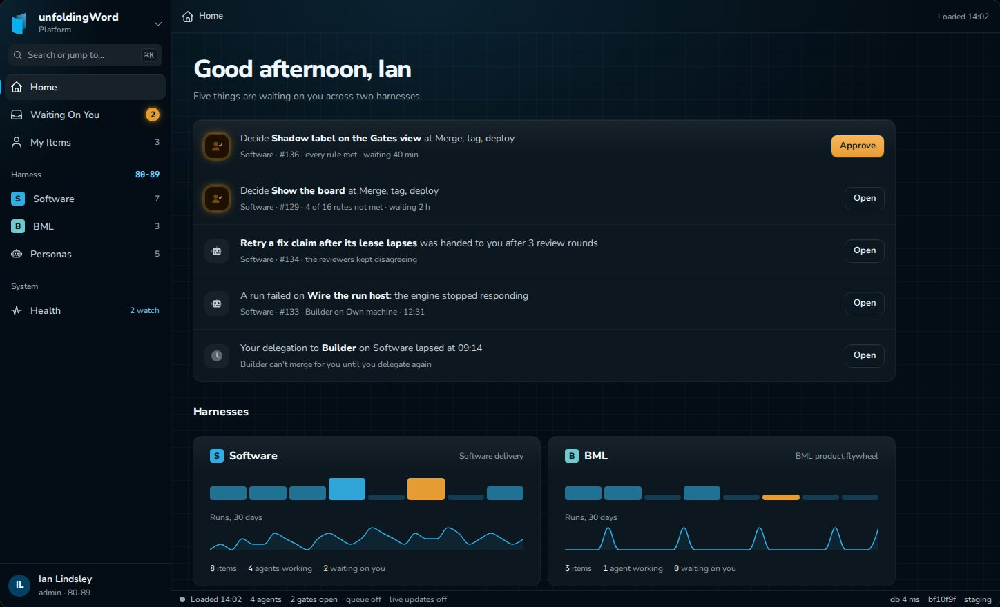

A greeting and the count of things waiting on the person, then each one with its action: a gate to decide (the decide-at-a-gate row carries Approve when every rule is met, Open otherwise), an item handed back after an engine refused it or after the review rounds ran out, a failed run, and a delegation that lapsed. Then one card per harness with its stages as small bars (the gate stage orange), a 30-day runs sparkline, and its items, agents working and waiting counts. Then whether push notifications are on for this browser. These are the four reasons `CONTEXT.md` gives for Home and nothing else.

### 4.3 Flow

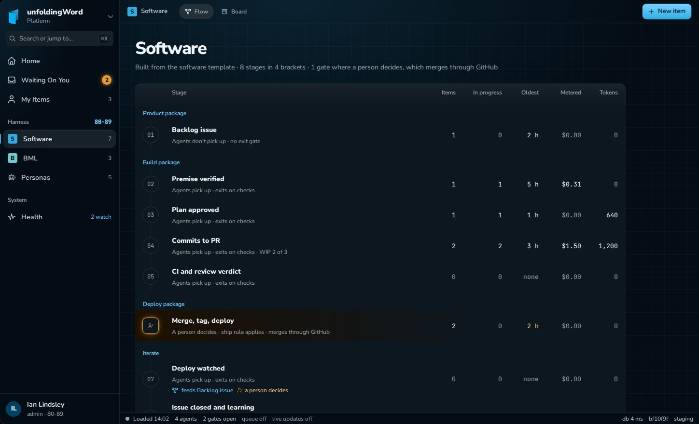

The harness's stages grouped by bracket (Product package, Build package, Deploy package, Iterate), each with whether agents pick it up and how it exits, and its items, in progress, oldest, metered cost and subscription tokens. The gate stage is drawn orange with the person mark. A stage that feeds an earlier one says so; the loop back to the first stage also says that a person decides it.

### 4.4 Board

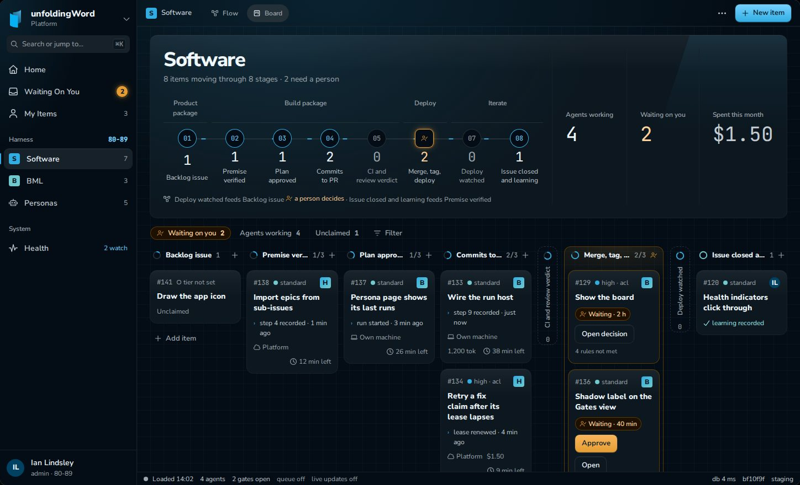

The pipeline: the display name, a one-line summary, the four brackets, eight numbered stage nodes on a rail with each stage's count (the gate node orange), and the loops. Beside it three figures: agents working, waiting on you, spent this month. Then filter chips (Waiting on you, Agents working, Unclaimed, Filter), then a column per stage. An empty stage folds to a narrow strip. The gate column glows faintly orange. A card shows its number, risk tier and domains, its holder, its title, its last event, its host, its cost or tokens and its lease time left; a card at the gate shows how long it has waited and its action. The BML harness uses the same screen with its own stage names:

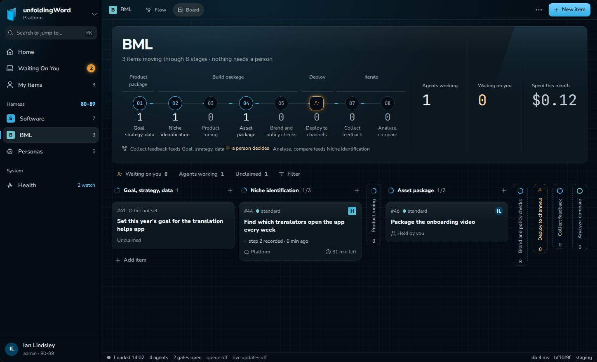

### 4.5 Gates

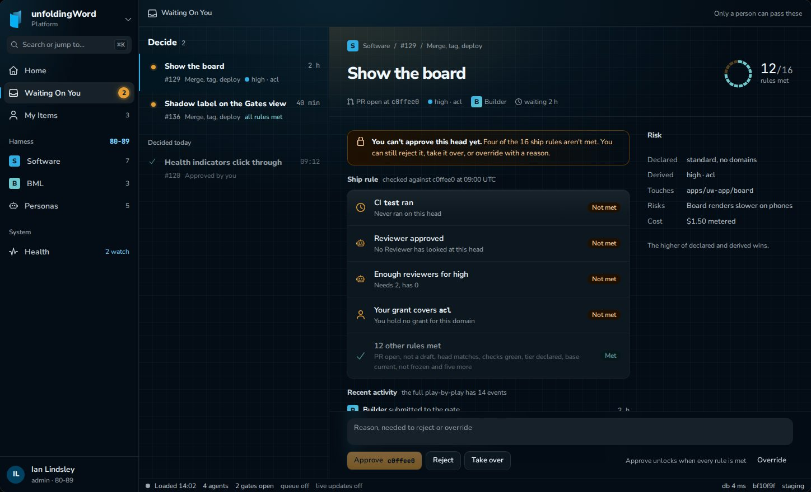

The decisions waiting on the person on the left, an orange dot on each, and decided today below. The open decision on the right: where it is, its title, a ring of the ship rule's checks met (16 segments), its pull request, head, risk and holder, a callout when it cannot be approved yet, the checks not met first with their reason, the met checks folded into one row, recent activity, and the risk declared and derived. The reason box and the four decisions are pinned at the bottom; Approve names the head it approves. On a phone the list and the decision open one at a time:

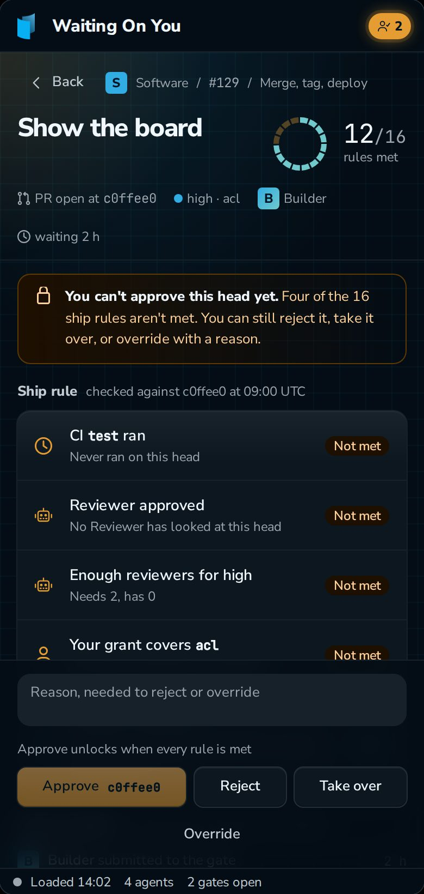

### 4.6 Play-by-play

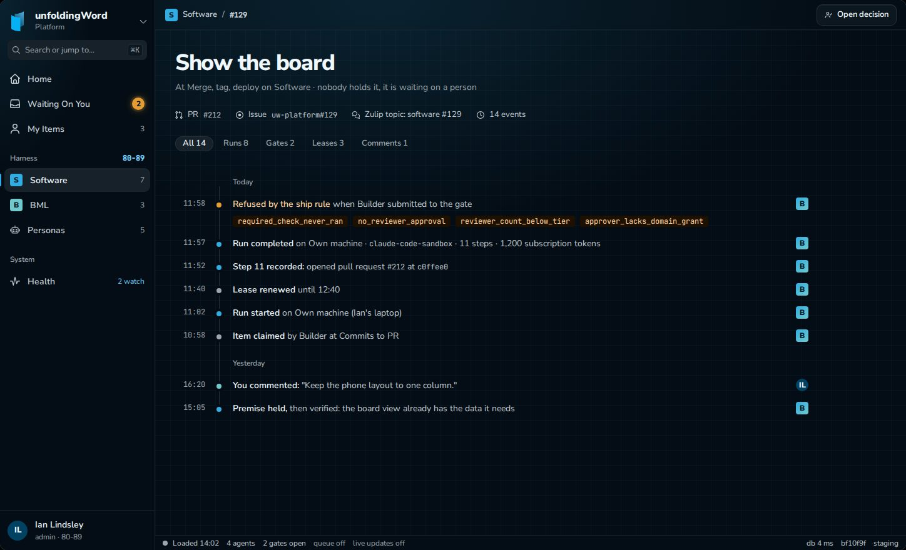

The item's title, where it is and who holds it; its pull request, issue and Zulip topic; filters by kind of event; then the events as a timeline grouped by day, each with its time, a dot coloured by kind (orange for a gate, blue for a run, teal for a comment, grey for a lease or a claim), the sentence, the actor, and the evidence (a refusal shows its closed-set reasons as codes).

### 4.7 Persona

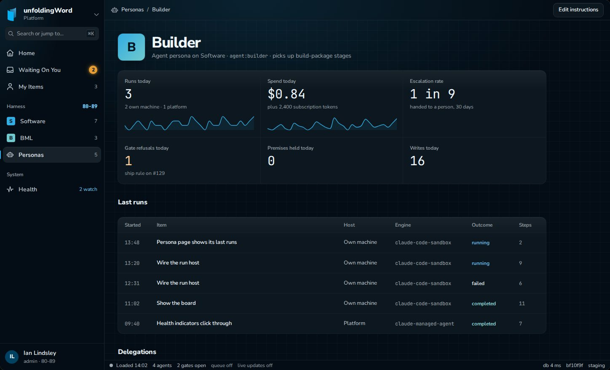

The persona's name, harness and identity; its figures (runs today with a 30-day sparkline, spend today with one, escalation rate, gate refusals today, premises held today, writes today, and for reviewers approves-at and refuted findings); its last runs (started, item, host, engine, outcome, steps); its delegations, a lapsed one offering to delegate again.

### 4.8 Health

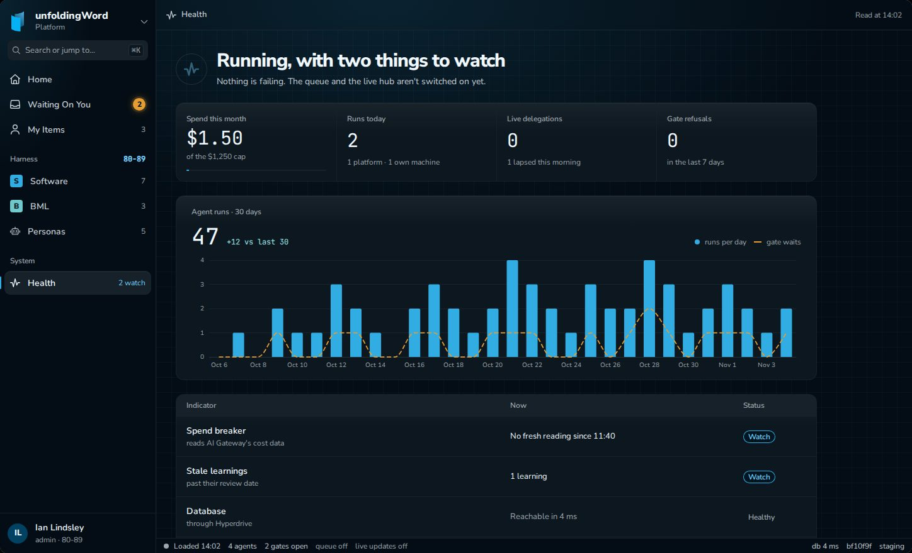

A sentence that says how the platform is, four figures (spend against the cap, runs today by host, live delegations, gate refusals this week), a 30-day chart of agent runs per day with gate waits as a line, and every indicator with its value now and its status. Healthy recedes; watch is blue and outlined; not switched on is grey. There is no red. Each row opens its detail.

### 4.9 Health detail

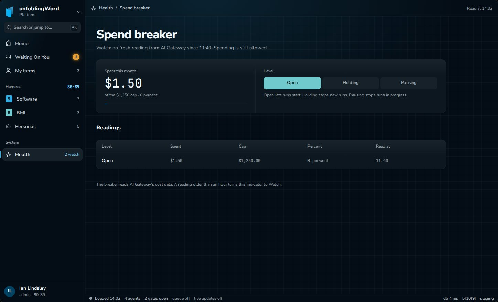

One indicator: its name, a sentence, its figures, and the listing behind it. The spend breaker shows spent against the cap and its level among open, holding and pausing.

### 4.10 Light and phone

Light uses the same roles. The Board, Gates and Health in light, and Home and the Board on a phone:

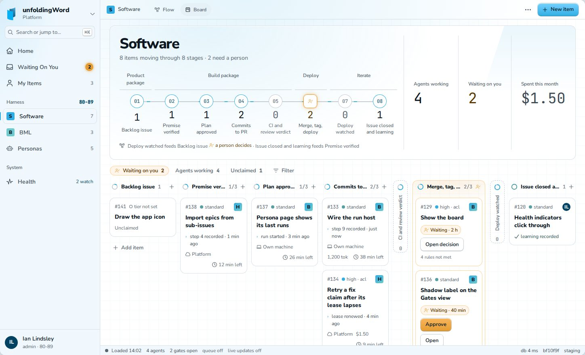
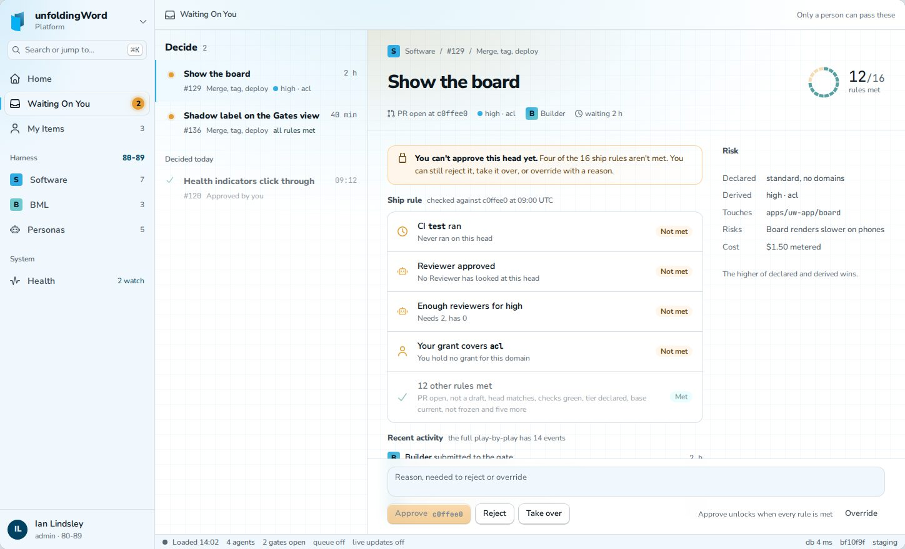
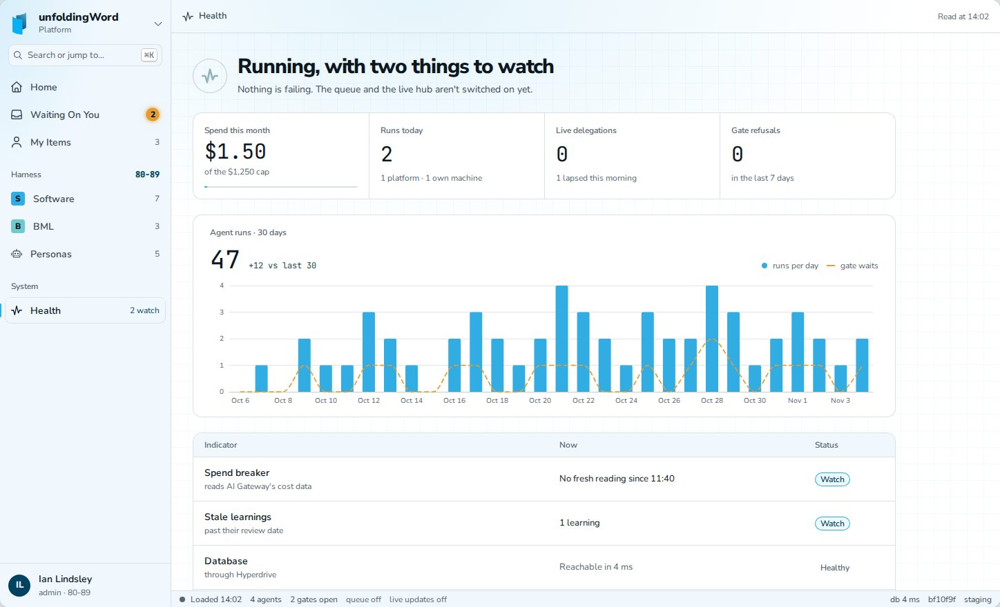
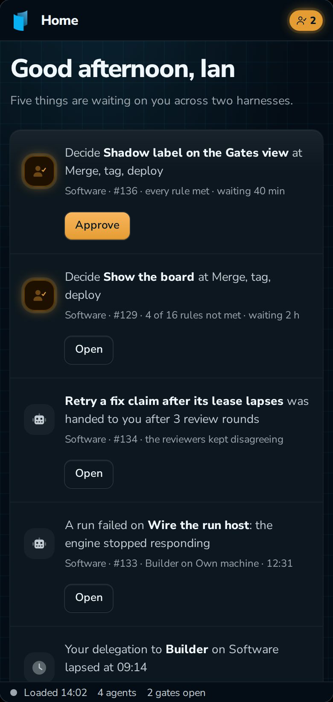
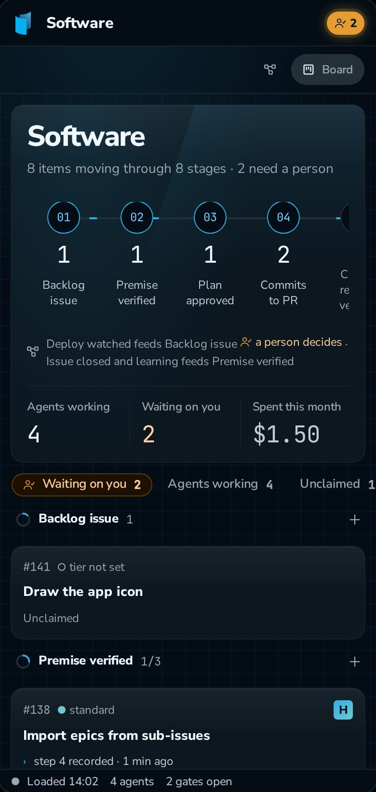

## 5. The token system

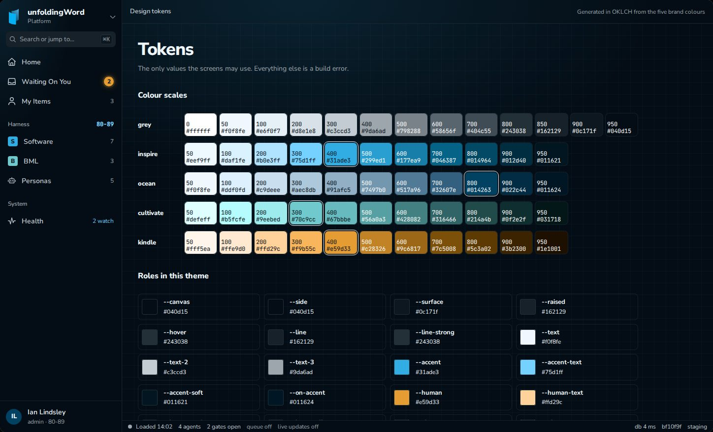

### 5.1 Colour scales

Computed in OKLCH: each step has a fixed lightness, the hue of its brand colour, and a chroma that eases off toward the ends; the brand hex replaces the step nearest it. Inspire sits at 400, Ocean at 800, Cultivate at 300, Kindle at 400. Tech (`#231f20`) remains the brand's near-black and is not a scale.

| Scale | 50 | 100 | 200 | 300 | 400 | 500 | 600 | 700 | 800 | 900 | 950 |
|---|---|---|---|---|---|---|---|---|---|---|---|
| inspire | `#eef9ff` | `#daf1fe` | `#b0e3ff` | `#75d1ff` | `#31ade3` | `#299ed1` | `#177ea9` | `#046387` | `#014964` | `#012d40` | `#011621` |
| ocean | `#f0f8fe` | `#ddf0fd` | `#c9deee` | `#aec8db` | `#91afc5` | `#7497b0` | `#517a96` | `#32607e` | `#014263` | `#022c44` | `#011624` |
| cultivate | `#defeff` | `#b5fcfe` | `#9eebed` | `#70c9cc` | `#67bbbe` | `#56a0a3` | `#428082` | `#316466` | `#214a4b` | `#0f2e2f` | `#031718` |
| kindle | `#fff5ea` | `#ffe9d0` | `#ffd29c` | `#f9b55c` | `#e59d33` | `#c28326` | `#9c6817` | `#7c5008` | `#5c3a02` | `#3b2300` | `#1e1001` |

The grey is tinted toward Ocean's hue and has extra dark steps for the dark canvas.

| Step | 0 | 50 | 100 | 200 | 300 | 400 | 500 | 600 | 700 | 800 | 850 | 900 | 950 |
|---|---|---|---|---|---|---|---|---|---|---|---|---|---|
| grey | `#ffffff` | `#f0f8fe` | `#e6f0f7` | `#d8e1e8` | `#c3ccd3` | `#9da6ad` | `#798288` | `#58656f` | `#404c55` | `#243038` | `#162129` | `#0c171f` | `#040d15` |

### 5.2 Roles

| Role | Light | Dark | Job |
|---|---|---|---|
| `--canvas` | grey 0 | grey 950 | The page |
| `--side` | grey 50 | grey 950 | The sidebar and status bar |
| `--surface` | grey 0 | grey 900 | Cards, tables, panels |
| `--raised` | grey 50 | grey 850 | Inputs, the selected nav item, table heads |
| `--hover` | grey 100 | grey 800 | Hover |
| `--line` | grey 200 | grey 850 | Hairlines |
| `--line-strong` | grey 300 | grey 800 | Outlines that must show |
| `--text` | grey 900 | grey 50 | Titles and values |
| `--text-2` | grey 700 | grey 300 | Body |
| `--text-3` | grey 600 | grey 400 | Labels, meta |
| `--accent` | inspire 400 | inspire 400 | The main action, focus, a working agent, "watch" |
| `--accent-text` | inspire 800 | inspire 300 | Text in the accent |
| `--accent-soft` | inspire 50 | inspire 950 | Accent backgrounds |
| `--on-accent` | ocean 950 | ocean 950 | Text on a filled accent or person button |
| `--human` | kindle 400 | kindle 400 | A person acts, and nothing else |
| `--human-text` | kindle 800 | kindle 200 | Text in that role |
| `--human-soft` | kindle 50 | kindle 950 | Its backgrounds |
| `--human-line` | kindle 200 | kindle 800 | Its outlines |
| `--ok` | cultivate 500 | cultivate 300 | Healthy, met, completed |
| `--ok-text` | cultivate 800 | cultivate 200 | Text in that role |
| `--ok-soft` | cultivate 50 | cultivate 950 | Its backgrounds |

Three derived roles mix a role with transparency and are themselves tokens: `--glow` (accent at 13%, for the faint light behind the work area), `--glow-human` (human at 14%) and `--gridline` (accent at 5%, the 24 px grid behind each screen). There is no red, as before.

Contrast, computed with the WCAG formula: every text role (`--text`, `--text-2`, `--text-3`, `--accent-text`, `--human-text`, `--ok-text`) on `--canvas`, `--surface` and `--raised`, and each text-on-soft pair, is at least 4.5:1 in both themes. The lowest is `--text-3` on `--canvas` in light, 5.99:1.

### 5.3 Type, spacing, radius, shadow

| Kind | Tokens |
|---|---|
| Size | `--text-xs` 12, `--text-sm` 13, `--text-base` 14, `--text-md` 16, `--text-lg` 20, `--text-xl` 24, `--text-2xl` 30, `--text-3xl` 36 (px) |
| Weight | 400, 600, 800 for Nunito Sans; JetBrains Mono at 400 for numbers, ids and commits only |
| Leading and tracking | 1.15, 1.35, 1.5; headings at -0.035em |
| Spacing | `--space-1` to `--space-8`: 4, 8, 12, 16, 24, 32, 48, 64 px, and nothing between |
| Sizes | `--size-1` to `--size-8` for icons, avatars and controls: 12, 16, 20, 24, 32, 36, 48, 64 px |
| Radius | 4, 8, 12 and full |
| Shadow | `--shadow-1` (resting: a lit top edge and a hairline), `--shadow-2` (lifted), `--shadow-3` (floating), `--shadow-key` (a button's lit top and dark bottom edge), `--shadow-person` (the orange glow, only where a person acts) |
| Layout | Named widths: sidebar 248, gates list 340, decision aside 260, content 1080, board column 150 to 320 (px) |

How the type is used: page titles 36 heavy; screen titles 30 heavy; section heads and harness names 16 heavy; card and row titles 14 heavy; body 13 or 14; labels and meta 12. Hierarchy comes from weight and colour before size: one heavy title line, then one quiet line of facts.

## 6. Requirements

The rows are PRD section 7.12. Each is proven by a test or a scenario named for its ID; none needs a live account or a secret.

| ID | Requirement |
|---|---|
| UI-1 | The token system of section 5 in `packages/ui/tokens/`, both themes, with a test that every text pair of section 5.2 passes 4.5:1 |
| UI-2 | The Tailwind theme is the token set and nothing else, spacing included; the build fails on an arbitrary value in a class and on a raw colour, size or shadow outside the token files |
| UI-3 | Nunito Sans and JetBrains Mono bundled and served from the Worker's assets |
| UI-4 | One icon component; Font Awesome Pro Regular when installed with the token, Duotone for large tiles; Font Awesome Free otherwise; the build, the tests and the screenshot check pass without the token |
| UI-5 | The frame of section 4.1 |
| UI-6 to UI-13 | The Board, Gates, Health, Home, Flow, Play-by-play, Persona and Health detail screens of section 4 |
| UI-14 | Charts with Apache ECharts as SVG: Health's runs chart and the sparklines |
| UI-15 | Three reads: runs and gate waits per day over 30 days, each item's last event, and the items the person holds |
| UI-16 | The screenshot check: every screen in light and dark, desktop and phone, rendered from the seeded fixtures in CI and compared with committed pictures |
| UI-17 | Title Case for navigation and page names; sentence case everywhere else |
| UI-18 | `harnesses.title`, backfilled from the key, set on creation and by an admin command, shown wherever a person reads a harness's name (section 7) |

## 7. Data and contracts

One column, `harnesses.title`, text, not null, with no default: Postgres cannot default one column to another. Its invariant:

- **Backfill.** The migration adds the column nullable, sets `title = key` on every existing row, then makes it not null, in one migration.
- **Creation.** The stages module, `harnesses`' one writer (`packages/harness/stages/owns.ts`), sets `title` on insert: the title the creating command carries if it carries one, otherwise the key.
- **Change.** An admin command `set_title` on the harness's area, the same shape as `set_hosted_builder`, sets it through a new write operation on the stages module and records a `title_set` harness event with strict evidence `{ from, to }`, the old and new title (PRD section 8.6). Nothing else writes it.
- **Key changes.** A harness's key never changes: the stages module has no operation that sets it. So title and key cannot drift; the title is free text once set, and a change to it never changes the key.

So "Software" and "BML" are titles an admin sets with `set_title` after the backfill leaves them as `software` and `bml`. Three reads, none of which adds a table: runs per day from `harness_runs.started_at` and gate waits per day from `harness_items.held_since` and `gate_decisions`, both over 30 days; the latest `harness_events` row per item; and items whose `claimed_by` is the viewer. Apart from `set_title` and `title_set`, no event, verb, command or closed set changes; no agent verb is added, and an agent cannot reach `set_title`.

## 8. Shared roots touched

| Root | Change | Commit |
|---|---|---|
| `docs/adr/` | ADRs 0011, 0012, 0013 | This pull request |
| `AGENTS.md` | Section 1's design row cites ADR 0011; section 6's copy rule gains Title Case for navigation; section 8 builds on a normal branch | This pull request |
| `packages/db/schema.ts` | `harnesses.title` | The build, step 22 |
| `packages/contracts/` | The `set_title` command and the `title_set` event | The build, step 22 |

## 9. Build order

PRD section 13, steps 21 to 25.

21. **Tokens and locks.** UI-1, UI-2, UI-3, UI-4, and the ECharts rendering spike of ADR 0012.
22. **The frame and names.** UI-5, UI-17, UI-18.
23. **Reads.** UI-15.
24. **Screens.** UI-6 to UI-14, one screen per task.
25. **The screenshot check.** UI-16, with the pictures taken last.

## 10. Release

1. PRD section 14 items 1 to 6 hold.
2. Every Must in section 6 has a test or scenario named for its ID.
3. The screenshot check passes in CI and fails when a planted change to a token value is added.
4. The build fails on a planted arbitrary Tailwind value and a planted raw colour.
5. Ian has looked at every screen's picture in light and dark, desktop and phone, and merged the pull request.

## 11. Not in v0.3.0

Lessons with statuses (V3-1). Live agent readouts, per-indicator history and a lease progress bar (V3-11). Search behind the search box: it is drawn and says it is not wired. The `design-system/` folder from Claude Design: when it lands it replaces section 5's files, as ADR 0007 said, and the screenshot check shows what that changes.

## 12. What this spec does not establish

That Font Awesome's licence permits the token install in CI and on Cloudflare: ADR 0013 records the assumption and who confirms it. That ECharts renders on the server under the content security policy: ADR 0012's spike decides between server and island rendering.
